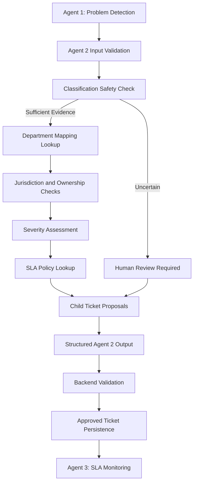

# Samadhan AI — Agent 2 Architecture

## 1. Overview

Agent 2 is the Resolution and Routing Agent in Samadhan AI. It receives structured problem analysis from Agent 1 and generates recommendations for department routing, severity assessment, SLA policy lookup, human review, and child-ticket proposals.

Agent 2 is a decision-support component. The backend is responsible for validating and persisting approved decisions.

## 2. Objectives

- Recommend departments using configured reference data.
- Assess the severity of each detected problem.
- Retrieve configured response and resolution SLA targets.
- Identify uncertain classifications that require human review.
- Support multiple independently actionable problems in one complaint.
- Propose child tickets linked to the original complaint.
- Avoid inventing categories, departments, policies, or deadlines.

## 3. High-Level Architecture

## 4. Component Responsibilities

### `schemas.py`

Defines the Pydantic input and output models, categories, severity values, review reasons, department recommendations, and child-ticket proposals.

### `policy_retriever.py`

Retrieves department mappings and SLA rules from configured reference data.

### `review.py`

Identifies cases requiring human review, including unknown categories, low confidence, missing evidence, unverified department mappings, unclear jurisdiction, and policy uncertainty.

### `severity.py`

Produces a severity recommendation and supporting rationale using the implemented severity logic.

### `sla.py`

Looks up configured response and resolution targets for a problem category and severity.

### `ticket_splitter.py`

Proposes child tickets for detected problems while preserving their relationship to the parent complaint.

### `routing.py`

Orchestrates the classification checks, department lookup, severity assessment, SLA lookup, review flags, and child-ticket proposals.

### `routing_reference_data.example.json`

Contains example department mappings and SLA rules for development. Its values are illustrative and must not be treated as official municipal policies.

## 5. Processing Workflow

1. Receive structured problem analysis from Agent 1.
2. Validate the input using Agent 2's schemas.
3. Evaluate each detected problem independently.
4. Check category, confidence, evidence, and uncertainty indicators.
5. Look up a department mapping when classification is sufficiently reliable.
6. Check department verification, jurisdiction, and asset ownership.
7. Recommend severity and retain the rationale.
8. Look up the applicable SLA policy.
9. Flag uncertain or unverified decisions for human review.
10. Propose child tickets for independently actionable problems.
11. Return a structured result for backend validation.

## 6. Classification Safety and Human Review

Human review is required when classification is unknown or uncertain, evidence is insufficient, Agent 1 explicitly requests review, the department mapping is unverified, jurisdiction is unclear, or required policy information is unavailable.

If the image or description cannot be classified reliably, Agent 2 must not guess a category or department.

A confidence score alone does not guarantee correctness. Explicit uncertainty and missing evidence must not be ignored.

## 7. SLA Policy Handling

SLA policies define configured response and resolution targets.

Agent 2 looks up these targets using the applicable category and severity. If classification is uncertain or no matching policy exists, the SLA values remain unavailable instead of being invented.

The example SLA values in the development configuration are not verified municipal requirements.

## 8. Parent and Child Ticket Proposals

A single complaint can contain multiple independently actionable problems. Agent 2 can propose a separate child ticket for each problem and retain the parent complaint ID.

A child-ticket proposal can include:

- Proposed ticket ID
- Parent complaint ID
- Problem ID
- Category
- Department recommendation
- Severity recommendation
- SLA targets, when available
- Human-review requirement

These are proposals, not persisted database records.

## 9. Integration Boundaries

### Agent 1 — Problem Detection

Detects and analyzes civic problems and supplies the structured problem information used by Agent 2.

### Agent 2 — Resolution and Routing

Produces department recommendations, severity assessments, SLA lookups, human-review flags, and child-ticket proposals.

### Backend

Validates recommendations, checks permissions and approval requirements, and persists accepted tickets.

### Agent 3 — SLA Monitoring and Escalation

Monitors accepted tickets against their established SLA deadlines and handles its assigned monitoring and escalation workflow.

Agent 2 does not persist tickets, assign officers, start SLA clocks, or monitor SLA breaches.

## 10. Production Considerations

Before production deployment:

- Replace demo department mappings with approved reference data.
- Configure verified municipal SLA policies.
- Validate jurisdiction and asset ownership.
- Align Agent 2 input models with Agent 1's actual output schema.
- Ensure review-required proposals cannot bypass approval.
- Validate all recommendations in the backend before persistence.
- Confirm that Agent 3 receives accepted tickets with established SLA deadlines.
- Verify Python imports and end-to-end behavior.

## 11. Current Status

Agent 2 is under development. Its example routing and SLA configuration is intended for development and demonstration until verified reference data and backend integration are complete.
