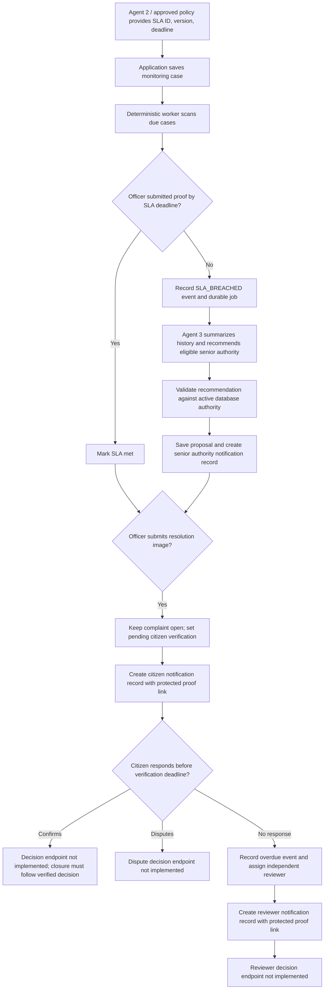

# Samadhan AI Agent 3: Monitoring and Escalation

**Purpose:** Explain the current Agent 3 implementation and the database and worker pieces that support it.

**Scope:** Agent 3 monitors assigned complaint work, reacts to confirmed SLA breaches, and routes unanswered resolution verification to an independent reviewer. It does not decide the SLA policy or perform the officer's work.

## 1. The three roles in this workflow

- **Agent 2 / approved policy data** supplies the selected SLA policy ID, its version, and the deadline. Agent 3 stores and monitors those values; it does not invent or calculate them.
- **Deterministic monitoring worker** checks due deadlines, updates states, records events, and creates durable jobs and in-app notification records. Deadline comparison is ordinary database/application logic; no language model is used for it.
- **Agent 3 (LLM)** is invoked only for a durable job created after the worker confirms an SLA breach. It summarizes the case history and may recommend an eligible senior authority from the configured database records. Its output is a proposal, not a policy decision or an independent action.

## 2. End-to-end workflow



The worker runs on a configurable interval and examines indexed due rows. It is a deterministic service, not an LLM polling loop. Only the escalation reasoning step calls the LLM, and only after an `SLA_BREACHED` event exists.

## 3. What happens when work is completed

1. The assigned officer submits an image through the resolution-proof route.
2. The image is stored privately; the database keeps an opaque evidence reference and media metadata.
3. The complaint is **not closed**. The monitoring case moves through `resolution_submitted` to `pending_citizen_verification`; the complaint status is `resolved_pending_verification`.
4. The citizen receives an in-app notification record and a protected proof URL.
5. If no citizen response arrives by the configured verification deadline, the worker records `VERIFICATION_OVERDUE` and assigns an eligible independent reviewer from the same jurisdiction, with no department affiliation.

The officer proof upload and protected proof reads are implemented. Citizen confirm/dispute actions and the reviewer decision endpoint are not yet implemented, so the final human decision and closure are not available. Notification records are persisted, but a user-facing inbox and email/SMS/WhatsApp delivery are not included.

### Officer proof API

- `POST /api/v1/staff/complaints/{public_reference}/resolution-proof` accepts an image from the assigned officer with the `complaint:resolve` permission.
- `GET /api/v1/complaints/{public_reference}/verification-proof` serves the proof only to the complaint owner.
- `GET /api/v1/staff/verification-reviews/{public_reference}/proof` serves it only to the assigned independent reviewer after the case enters `review_required`; the token must include `complaint_verification:review`.
- Upload stores a normalized private image and metadata, changes the complaint status to `resolved_pending_verification`, and does not close it. The deterministic worker starts the citizen verification window and records the citizen notification on its next scan.

These routes require an existing `monitoring_cases` record. The Agent 2 assignment workflow is not wired to register it automatically.

## 4. What happens when an SLA is breached

1. The worker locks due active cases to prevent duplicate processing.
2. It treats work as timely if the officer's completion/proof submission was recorded at or before the stored deadline. Otherwise it records `SLA_BREACHED`, marks escalation open, and creates one idempotent durable job.
3. A worker claims the job with a lease and retry limit.
4. The LLM receives bounded case history, the recorded policy ID/version/deadline, and candidates already selected from active authority records.
5. The returned recommendation is checked against the current authority records. If eligible, the proposal is stored and an in-app notification record is created for that senior authority.

The model cannot choose a person outside the supplied authority list, change a deadline, close a complaint, or claim a notification was delivered. The real-world authority hierarchy and eligibility data must be approved and loaded by the project.

## 5. Database tables

| Table | Purpose |
|---|---|
| `monitoring_cases` | One monitoring record per complaint; stores assigned officer, Agent 2's SLA reference/version/deadline, work state, verification state, proof reference, and escalation state. |
| `monitoring_authorities` | Approved senior-authority and independent-reviewer directory used to find eligible recipients. |
| `monitoring_events` | Append-oriented record of breach, verification, and Agent 3 proposal events. Idempotency keys help prevent duplicates. |
| `monitoring_jobs` | Durable, retryable Agent 3 work created from a confirmed breach event. |
| `monitoring_notifications` | Durable in-app notification records for citizens, senior authorities, and reviewers. It is not itself an email or SMS service. |

Existing tables are also used: `complaints` holds the complaint and citizen owner; `complaint_events` provides complaint history; `complaint_media` stores image metadata while the image bytes live in private object storage.

Authority subject fields on `monitoring_cases` correspond to identity subjects but are not foreign keys because the identity provider is external. `monitoring_cases.complaint_id` references `complaints.id`.

## 6. Important states

| Record | State | Meaning |
|---|---|---|
| SLA | `active` | Waiting for the recorded deadline or officer completion. |
| SLA | `met` | Completion/proof submission was recorded by the deadline. |
| SLA | `breached` | Deadline passed without completion recorded by that deadline. |
| Work | `resolution_submitted` | Officer submitted proof; verification has not yet started. |
| Work | `pending_citizen_verification` | Proof is available and the citizen has a response window. This is not closed. |
| Verification | `pending_citizen` | Waiting for citizen confirmation or dispute. |
| Verification | `review_required` | No citizen response by the deadline; reviewer assignment is required. |
| Verification | `approved` / `disputed` | Reserved states; decision endpoints are not implemented yet. |

## 7. Run the database migration and worker

From the project root, configure PostgreSQL in `.env`, then apply all migrations:

```powershell
alembic -c backend/alembic.ini upgrade head
```

Load only approved authority-directory records into `monitoring_authorities`. The application integration should register each case using Agent 2's already-selected policy and deadline. Then start the deterministic worker in a separate process:

```powershell
python -m backend.app.workers.monitoring_worker
```

For a single local iteration, use:

```powershell
python -m backend.app.workers.monitoring_worker --once
```

## 8. Configuration and decisions still needed

- The current verification window defaults to **168 elapsed hours (7 days)** and is configurable. Confirm the production policy and timezone/DST treatment before real use.
- The configured authority directory must reflect the approved jurisdiction and department hierarchy. Reviewer independence must be enforced by trusted data and permissions.
- Confirm image storage, malware scanning, retention, and model-provider data handling before production.
- Implement citizen confirmation/dispute and reviewer decision endpoints, with audit history and permission checks, before enabling complaint closure.
- Add a notification inbox or approved delivery adapter if users need to receive these records outside the application.
- Multi-department parent/child tickets are outside the current one-monitoring-case-per-complaint schema.

## 9. Source locations

- Agent contract: `backend/app/agents/monitoring_escalation.py`
- Deterministic monitor and durable jobs: `backend/app/workers/monitoring_worker.py`
- Agent 2 SLA registration and officer proof integration: `backend/app/monitoring.py`
- Database models: `backend/app/models.py`
- Agent 3 migration: `backend/migrations/versions/0004_agent3_monitoring.py`
- Existing implementation notes: `docs/architecture/agent3-monitoring-implementation.md`
