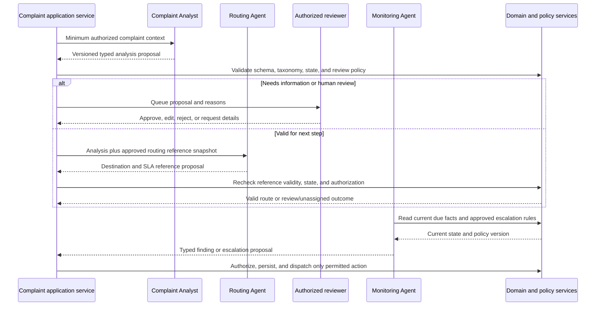

# AI agent architecture and contracts

**Status:** Proposed; no agents or orchestration code are implemented. This document defines interfaces and safety boundaries for later work.

## 1. Design rules

1. Agents produce typed proposals; application services own authorization, policy enforcement, state transitions, persistence, and side effects.
2. The system must support the complaint lifecycle when every model/provider is unavailable.
3. Every input is minimized and assembled from data the invoking workflow is authorized to use.
4. Every output is validated against a versioned schema and approved reference data before presentation or use.
5. Agent uncertainty, missing context, timeout, and invalid output are explicit outcomes that can go to human review.
6. Agents never invent departments, officers, jurisdictions, SLA rules, policy text, or evidence.
7. Tools are allowlisted, typed, bounded, and routed through application interfaces; agents get no direct unrestricted SQL, shell, or network access.

## 2. Invocation envelope

Each invocation should carry an envelope conceptually containing:

- `run_id` and request/correlation ID;
- agent name, contract/schema version, and invocation purpose;
- initiating actor or approved system trigger;
- complaint reference and state/version observed at invocation time;
- minimum necessary, authorized complaint context;
- approved taxonomy/reference/policy version identifiers as applicable;
- deadline, retry budget, token/cost budget, and allowed tool names;
- privacy classification and applicable retention/redaction instructions.

Exact field names are not API commitments. Do not include secrets, unnecessary direct identifiers, or unrelated complaint histories. Persist only the run metadata and inputs/outputs justified by audit, evaluation, and privacy requirements.

## 3. Shared result envelope

Every agent response should be represented as a typed result with:

- contract version and run ID;
- outcome: `completed`, `needs_review`, `insufficient_context`, `invalid`, or `failed` (candidate names);
- structured proposal, or explicit absence of one;
- uncertainty/confidence information with a team-defined interpretation;
- evidence/source references and policy/reference version IDs where applicable;
- validation issues and warnings;
- recommended next step, if any, clearly distinguished from an authorized action.

Do not accept free-form prose as the sole machine-readable decision. The final schema, confidence semantics, and retained evidence are pending design review.

## 4. Agent contracts

### Agent 1 — Complaint Analyst

**Purpose:** help triage the reported issue and identify missing details. 
**Inputs:** complaint text and only permitted structured details; approved category/severity/priority definitions; optionally allowed jurisdiction context. 
**Proposed output:** extracted facts with source spans/references; candidate category; candidate severity/priority tied to approved definitions; missing-information questions; possible duplicate complaint references with evidence; uncertainty and review flags. 
**Application checks:** validate taxonomy identifiers; preserve fact versus inference distinction; enforce prompt/data size limits; apply approved review thresholds; confirm duplicate references are accessible and never merge records automatically. 
**Permitted tools:** read-only lookup against an approved taxonomy and, if approved, privacy-filtered candidate search. 
**Forbidden actions:** edit complaint, request information directly, contact citizen, reject/merge/close reports, assign work, or claim facts absent from input. 
**Human review:** required for uncertain classification, conflicting evidence, sensitive/high-impact category, proposed duplicate relationship, or policy-defined cases.

### Agent 2 — Resolution and Routing Agent

**Purpose:** propose an operational destination and next action using authorized reference data. 
**Inputs:** validated analyst result, complaint location/jurisdiction signals, and an approved snapshot of department/team eligibility and SLA rules. 
**Proposed output:** one or more candidate destinations identified by existing stable reference IDs; matching jurisdiction and eligibility evidence; applicable SLA rule ID/version; rationale; missing-reference and review flags. 
**Application checks:** every identifier must resolve to approved effective data; eligibility and actor permissions are checked again at application time; state/version is rechecked before assignment; an unmapped case enters the configured unassigned review queue. 
**Permitted tools:** read-only search of approved department, jurisdiction, team/officer eligibility, and SLA references. 
**Forbidden actions:** create or invent reference records, alter SLA values, commit an assignment, notify staff/citizens, or override authorization. 
**Human review:** required when multiple destinations conflict, reference data is incomplete/stale, proposal is uncertain, or policy requires approval.

### Agent 3 — Monitoring and Escalation Agent

**Purpose:** identify delay/breach conditions and suggest permitted follow-up. 
**Inputs:** current complaint state/timestamps, approved SLA clock result and rule version, escalation policy, and prior escalation/notification outcomes. 
**Proposed output:** due/at-risk/breached finding; calculation inputs/references; candidate escalation action and recipient class from an allowlist; urgency and review flag. 
**Application checks:** deterministic SLA calculation is authoritative; verify policy version and current state; deduplicate repeated findings/actions; authorize any dispatch or status mutation; record outcome. 
**Permitted tools:** read-only access to monitoring facts and approved policy; may submit an escalation proposal through a typed application endpoint. 
**Forbidden actions:** change SLA clocks or policy, alter complaint state, close complaint, select arbitrary recipients, or send unrestricted messages. 
**Human review:** required for non-routine actions, policy ambiguity, disputed cases, or actions requiring supervisor authority.

## 5. Orchestration and handoff

The orchestration layer may pause for a reviewer, resume from a recorded decision, or terminate safely. Whether this uses LangGraph or straightforward application code is pending ADR-001 and prototype evidence.

## 6. Tool and execution controls

- Register tools by explicit name, typed input schema, allowed agent, permission scope, timeout, and side-effect class.
- Prefer read-only tools. Side-effect tools should be narrow application use cases requiring actor/system authorization and idempotency.
- Validate tool arguments and outputs; reject unknown IDs, oversized content, unexpected URLs, and malformed responses.
- Use per-invocation limits for time, retries, tokens/cost, concurrency, and context length.
- No arbitrary SQL, shell, unrestricted HTTP, dynamic tool discovery, or secret access.
- Defend against prompt injection in complaint text, attachments, retrieved documents, and provider responses: treat content as data, not instructions; constrain tools; apply domain checks after every proposal.
- Record tool name, input/output references, outcome, and actor/run correlation with sensitive-field redaction.
- Preserve separation between a model's suggested action and the application event that actually occurred.

## 7. Failure and degraded-mode behavior

| Condition | Required behavior |
|---|---|
| Timeout, rate limit, or provider outage | Stop within a bounded deadline; record failure; keep complaint state consistent; use manual review or retry policy. |
| Malformed or schema-invalid response | Reject response; do not parse free text into an action; record validation issue and provide human/manual path. |
| Unknown department/officer/SLA/category ID | Reject the proposal or route to reference-data review; never create an implicit record. |
| Low confidence or conflicting outputs | Return `needs_review`; show relevant evidence/uncertainty to authorized reviewer. |
| Complaint changed during invocation | Mark proposal stale; re-read current state and rerun/review; do not apply based on stale context. |
| Tool/integration failure | Record the outcome; retry only when safe and bounded; do not claim a notification/assignment occurred without confirmation. |
| Harmful or adversarial input | Apply content safety and tool restrictions; retain only necessary information; do not let embedded instructions change system policy. |

## 8. Human review record

For a reviewed proposal, capture reviewer identity, time, decision (approve/edit/reject/request information), reason where required, original proposal reference, edited values, policy version, and resulting application event. The review record must distinguish what the model suggested from what the person authorized. Define reviewer role, separation-of-duties rules, appeal, and audit retention with policy owners.

## 9. Evaluation and change management

Before enabling an agent in a real workflow, define an approved evaluation dataset and governance, representative language/complaint coverage, quality and error metrics, acceptance thresholds, privacy safeguards, bias/impact review, and regression process. Version prompts, schemas, model/provider settings, and reference data. Material changes require review and evaluation before release. Do not send real citizen data to an unapproved provider or use it for training without explicit policy authorization.

## 10. Open decisions

- Whether any agent is included in the MVP or the first lifecycle is fully manual.
- Agent framework/orchestrator and model provider, supported models, region, retention, and cost limits.
- Category taxonomy and meanings of severity, priority, confidence, and duplicate candidate.
- Which review conditions are mandatory and who owns each queue.
- Permitted read-only lookups and any side-effect tools, including action-specific approval needs.
- Run input/output retention, redaction, access, and audit detail.
- Evaluation data ownership, quality thresholds, bias review, and model/prompt change approval.
