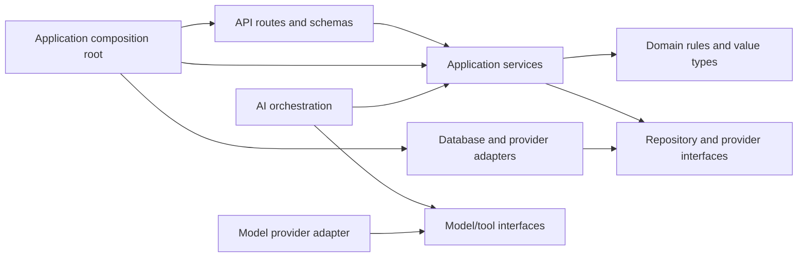

# Backend architecture proposal

**Status:** Target module boundaries aligned to the supplied blueprint; policy/operations details remain open.<br>
**Implementation state:** The backend is a partial authenticated complaint intake/tracking slice with required image upload, private local media storage, a PostgreSQL-backed analysis job, a Complaint Analyst worker, a capability-protected read-only analysis review queue, and a configurable provisional MVP taxonomy/priority framework. Municipal policy approval, review assignment/dispositions/retries, production media controls, routing, SLA worker, notifications, broader staff APIs, and citizen verification remain open. See [backend README](../../backend/README.md).

## 1. Design goals

- Keep the MVP in one deployable Python application unless a measured requirement supports another process or service.
- Keep HTTP, domain rules, persistence, AI, and providers from depending on one another in uncontrolled ways.
- Make authorization and complaint lifecycle rules explicit and testable.
- Ensure model output and external side effects cannot bypass application policy.
- Let frontend, AI, and integration contributors work against versioned contracts without assuming separate services.

## 2. Proposed module structure

The following is a starting package map. Adopt only the modules needed by an agreed implementation slice; do not create empty boilerplate packages.

```text
backend/                         # proposed project root
  app/                           # composition root, startup/shutdown, dependency wiring
  config/                        # validated settings and environment configuration
  api/
    routes/                      # HTTP endpoints grouped by resource/use case
    schemas/                     # request/response models, separate from persistence models
    dependencies/                # authenticated actor, authorization context, service wiring
    errors.py                    # stable error mapping and safe response envelope
  identity/                      # identity adapter, role/capability checks, access scopes
  complaints/
    domain/                      # complaint, state transitions, invariants, domain events
    application/                 # submit, view, request-info, transition, resolve use cases
    ports.py                     # repository/notification/analysis interfaces as needed
  organization/                  # department, officer eligibility, jurisdiction reference data
  assignments/                   # route proposal checks, assignment/reassignment use cases
  sla/                           # approved rule lookup, clock calculation, effective versions
  monitoring/                    # due evaluation and escalation policies/use cases
  notifications/                 # notification intents, templates, delivery status
  ai/                            # typed contracts, context builder, orchestration, harness
  audit/                         # attributable business events and privileged action records
  persistence/                   # ORM mappings, repositories, transaction/session management
  migrations/                    # Alembic database migration history (used by current starter)
  integrations/                  # model, email/SMS, authority provider adapters (only when approved)
  observability/                 # structured logging, metrics, tracing/correlation
```

Names can change to match the selected framework. The separation of responsibilities is the important part.

## 3. Dependency direction



The domain should not import FastAPI, ORM models, LLM SDKs, or provider-specific types. Application services coordinate domain behavior and ports. Adapters implement ports. The composition root wires concrete implementations. AI orchestration may call application-defined read/proposal interfaces, but domain services do not call an LLM to decide authorization or invariants.

## 4. Module responsibilities

### API routes and schemas

- Translate HTTP requests into application commands/queries and map results to explicit response schemas.
- Validate shape, size, and syntactic constraints at the boundary.
- Resolve an authenticated actor and pass authorization context to the use case.
- Return stable status/error codes and correlation identifiers.
- Avoid direct ORM queries, lifecycle policy, AI prompts, or provider calls in route handlers.

### Identity and authorization

- Establish actor identity from the approved authentication mechanism.
- Evaluate capability plus complaint/resource scope for every protected use case.
- Centralize policy helpers so endpoints do not implement inconsistent access checks.
- Distinguish citizen ownership, staff assignment/department/jurisdiction scope, and administrative capabilities.
- Keep agent/service identities constrained to explicit system operations; never equate “AI” with an administrator.

Authentication provider, token/session design, authorization model, and exact role matrix remain undecided. See [roles and use cases](../requirements/user-roles-and-use-cases.md).

### Application services

Implement use cases such as `SubmitImageComplaint`, `QueueAnalysis`, `RequestInformation`, `ProposeRoute`, `CreateChildTickets`, `AssignComplaint`, `RecordProgress`, `EvaluateDueSLAs`, `SubmitResolution`, `VerifyResolution`, and `ReviewDispute`. Names are illustrative. A use case owns permission checks, transaction boundaries, idempotency, parent/child invariants, and audit/domain events. Persist the complaint and durable work intent before any model call.

### Domain model

Represent complaint state, allowed transitions, assignment constraints, SLA concepts, and closure invariants independent of HTTP and persistence. Keep transition behavior explicit and deterministic. The final state set and policies require approval before encoding them as enums/rules.

### Persistence and repositories

- Map persistence rows to domain/application types at a controlled boundary.
- Enforce agreed invariants with transactions, foreign keys, unique constraints, checks, and concurrency controls.
- Keep query methods scoped and purpose-specific; do not expose arbitrary query capabilities to agents.
- Keep schema changes in Alembic migrations; the target database is PostgreSQL and concrete server versions require confirmation.

The target stack recommends PostgreSQL, SQLAlchemy, and Alembic. Current code already uses SQLAlchemy/Alembic, but these choices and supported PostgreSQL version still require team confirmation. The target uses pgvector for approved policy retrieval; it is not implemented.

### AI orchestration and execution controls

- Define versioned input/output schemas per agent use case.
- Build context from authorized, approved data and minimize sensitive fields.
- Validate result schema, identifiers, policy references, and confidence/uncertainty before application use.
- Bound time, retries, tokens/cost, and tool permissions; record run metadata and human disposition.
- Produce a proposal or review item; call a domain/application action only through an explicit authorized use case.

The supplied blueprint recommends LangGraph with PostgreSQL-backed workflow persistence where appropriate. Keep provider/model adapters replaceable so deterministic/manual workflows remain available without an agent response. Exact framework version and persistence approach require a prototype and approval.

### External integrations and notifications

- Normalize provider request/response types behind interfaces.
- Apply allowlisted destinations and operations, scoped credentials, timeouts, retry policy, idempotency, and safe error mapping.
- Treat notification/authority provider outcomes as separate from the authoritative complaint state.
- Do not create provider-specific coupling in domain logic.

### Configuration, audit, and observability

- Load configuration from validated environment settings; secrets come from the chosen deployment secret manager.
- Add correlation/run identifiers to logs and relevant records.
- Record actor, action, target, time, reason/policy version, and outcome for privileged changes and material transitions.
- Redact secrets and unnecessary PII from logs and model context.
- Keep operational logs distinct from durable business audit history.

## 5. Transaction and side-effect boundaries

### Database transaction

For a state-changing use case, authorize the actor, read the current state/version, check domain preconditions, and persist the change with its required business event/audit records in one transaction. Repeatable event producers use a stable key for the logical operation and a database uniqueness constraint scoped to complaint and event type; duplicate-key handling returns the already-recorded logical outcome without repeating state changes or downstream job creation. Commit before reporting success. On a concurrency conflict, return a stable conflict and require the caller to refresh/review. Exact key representation and retention remain physical-schema decisions.

### External work

Do not hold a database transaction open while waiting for an LLM, email/SMS provider, or authority API. Commit the domain change, its complaint/business event, and any required PostgreSQL-backed durable job intent atomically; the job owns claiming/lease, attempts, retry schedule, and terminal outcome, while the business event owns the auditable complaint timeline. Event identity is separate from job identity: event idempotency prevents duplicate logical timeline records; job idempotency prevents duplicate work creation, and attempt state supports retry/recovery. Workers and consumers must tolerate repeated execution and revalidate current state before applying results. Provider calls use bounded timeouts and provider idempotency where supported; an unknown provider outcome without deduplication must be recorded and reconciled, not described as exactly-once delivery. The target blueprint requires a scheduled Python worker for async analysis, notifications, and deterministic SLA processing. Choose the scheduler and safe-claim mechanism against hosting constraints; a database is not itself a scheduler.

The initial design defers a separate transactional outbox: PostgreSQL-backed jobs are sufficient for work intent consumed by the project's own worker, provided they are inserted in the same transaction as the domain change. If broker/event publication is later required, evaluate an outbox that is written atomically, retried independently, and consumed idempotently. Do not use complaint timeline events as a job queue or conflate either with provider delivery state.

### Durable worker recovery

Workers select due rows through indexes on status, availability/run-after time, and lease expiry, in bounded batches. Claim rows atomically with a PostgreSQL-safe mechanism (for example, row locking with `SKIP LOCKED`) and lease owner/expiry so concurrent workers do not execute the same lease concurrently. Persist attempt count, next retry time, safe failure details, and terminal outcome. Retry transient failures with bounded backoff; mark permanent/exhausted work terminal and expose it to operators. On restart, expired leases and overdue jobs become eligible again. Handlers must be idempotent, re-read target state before applying results, and use domain-event/job uniqueness to avoid duplicate logical effects.

Reconciliation scans compare due verification deadlines, pending review cases, and notification intents with durable work so missing or stranded jobs can be recreated idempotently. Business status (for example, a complaint awaiting verification) remains distinct from job status. SLA evaluation is deterministic and batched; no repeated LLM polling. Invoke Monitoring & Escalation only for an actual breach event that needs its recommendation. The demo deployment must report scheduler lag, backlog, expired leases, retries, and terminal failures, and document downtime recovery; do not claim continuous monitoring unless the host guarantees it. Lease duration, batch size, retry/backoff limits, alert thresholds, and scheduler mechanism are implementation/deployment choices to validate.

### AI sequence

Call AI with a snapshot of minimum necessary inputs outside the mutation transaction. Validate its response. Then start a new application operation that rechecks current authorization, current complaint state, and reference-data validity before applying any permitted result. A stale proposal must not overwrite newer facts.

## 6. API error and exception handling

Map expected domain and application outcomes into stable API errors. The initial FastAPI slice already normalizes validation failures, HTTP exceptions (including framework 404/405), and unexpected failures with the documented safe envelope and correlation ID. Do not return stack traces, SQL, prompts, credentials, internal topology, or another user's data. Exact status/code registry remains subject to team approval; see [error-handling contract](../api/error-handling.md).

## 7. Testing strategy by boundary

- **Domain:** deterministic tests for transitions, invariants, policy precedence, and date calculations.
- **Application services:** actor/scope authorization, transaction outcomes, idempotency, missing reference data, and review paths.
- **Persistence:** repository scope, constraints, migrations, transaction rollback, and concurrency against the selected database.
- **API:** request/response schemas, stable errors, object-level access, pagination, and OpenAPI compatibility.
- **AI:** schema-valid and invalid results, unknown identifiers, timeout, provider outage, low-confidence/manual review, and stale proposal handling using fakes.
- **Integrations:** adapter contract tests for success, timeout, throttling, malformed response, retry, and duplicate delivery behavior.
- **End-to-end:** a minimal complaint journey from citizen intake through authorized verification/closure, with external providers stubbed where appropriate.

Test runner, database test environment, lint/type tools, and CI remain team decisions. Do not rely on live model calls for deterministic business-rule tests.

## 8. Implementation sequence recommendation

1. Confirm role grants, anonymous tracking security details, normalized state names/transitions, taxonomy, and data ownership. Implement the 48-hour citizen confirm/dispute workflow and reminder, then the intended seven-calendar-day overdue-review handoff with jurisdiction-timezone deadline semantics, durable recovery, late-response serialization, and assigned reviewer outcomes.
2. Extend the current slice to image validation/private storage and persist complaint plus durable async analysis job before model calls.
3. Add the Complaint Analyst and human review; then policy-grounded routing validation.
4. Build the deterministic recoverable SLA worker, durable idempotent events, and recovery checks.
5. Add parent-child tickets with independent child assignments/SLAs/history, aggregation and routing-loop controls; invoke Monitoring & Escalation only from valid events; add notification records.
6. Add officer work, evidence submission, the 48-hour citizen confirmation/dispute flow, and independent review. Implement the intended seven-calendar-day verification-overdue routing after deadline, retry/recovery, and reviewer outcome details are specified.
7. Harden authorization, recovery, privacy, performance, and acceptance tests; connect optional email/MCP/authority integrations only when approved.

AI remains optional for transaction correctness and core recordkeeping; its analysis runs asynchronously after durable complaint persistence.
