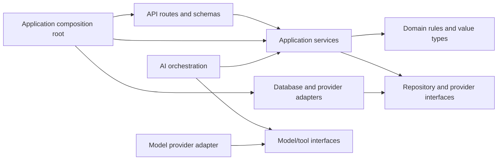

# Backend architecture proposal

**Status:** Proposed; pending Team Kafka/backend review<br>
**Implementation state:** A first complaint intake/tracking slice has been scaffolded under `backend/`. This document defines target module boundaries; the current code is partial and does not implement the complete MVP.

## 1. Design goals

- Keep the MVP in one deployable Python application unless a measured requirement supports another process or service.
- Keep HTTP, domain rules, persistence, AI, and providers from depending on one another in uncontrolled ways.
- Make authorization and complaint lifecycle rules explicit and testable.
- Ensure model output and external side effects cannot bypass application policy.
- Let frontend, AI, and integration contributors work against versioned contracts without assuming separate services.

## 2. Proposed module structure

The following is a starting package map. Adopt only the modules needed by an agreed implementation slice; do not create empty boilerplate packages.

```text
backend/                         # proposed project root
  app/                           # composition root, startup/shutdown, dependency wiring
  config/                        # validated settings and environment configuration
  api/
    routes/                      # HTTP endpoints grouped by resource/use case
    schemas/                     # request/response models, separate from persistence models
    dependencies/                # authenticated actor, authorization context, service wiring
    errors.py                    # stable error mapping and safe response envelope
  identity/                      # identity adapter, role/capability checks, access scopes
  complaints/
    domain/                      # complaint, state transitions, invariants, domain events
    application/                 # submit, view, request-info, transition, resolve use cases
    ports.py                     # repository/notification/analysis interfaces as needed
  organization/                  # department, officer eligibility, jurisdiction reference data
  assignments/                   # route proposal checks, assignment/reassignment use cases
  sla/                           # approved rule lookup, clock calculation, effective versions
  monitoring/                    # due evaluation and escalation policies/use cases
  notifications/                 # notification intents, templates, delivery status
  ai/                            # typed contracts, context builder, orchestration, harness
  audit/                         # attributable business events and privileged action records
  persistence/                   # ORM mappings, repositories, transaction/session management
  migrations/                    # database migration history (tool TBD)
  integrations/                  # model, email/SMS, authority provider adapters (only when approved)
  observability/                 # structured logging, metrics, tracing/correlation
```

Names can change to match the selected framework. The separation of responsibilities is the important part.

## 3. Dependency direction



The domain should not import FastAPI, ORM models, LLM SDKs, or provider-specific types. Application services coordinate domain behavior and ports. Adapters implement ports. The composition root wires concrete implementations. AI orchestration may call application-defined read/proposal interfaces, but domain services do not call an LLM to decide authorization or invariants.

## 4. Module responsibilities

### API routes and schemas

- Translate HTTP requests into application commands/queries and map results to explicit response schemas.
- Validate shape, size, and syntactic constraints at the boundary.
- Resolve an authenticated actor and pass authorization context to the use case.
- Return stable status/error codes and correlation identifiers.
- Avoid direct ORM queries, lifecycle policy, AI prompts, or provider calls in route handlers.

### Identity and authorization

- Establish actor identity from the approved authentication mechanism.
- Evaluate capability plus complaint/resource scope for every protected use case.
- Centralize policy helpers so endpoints do not implement inconsistent access checks.
- Distinguish citizen ownership, staff assignment/department/jurisdiction scope, and administrative capabilities.
- Keep agent/service identities constrained to explicit system operations; never equate “AI” with an administrator.

Authentication provider, token/session design, authorization model, and exact role matrix remain undecided. See [roles and use cases](../requirements/user-roles-and-use-cases.md).

### Application services

Implement use cases such as `SubmitComplaint`, `GetComplaintForActor`, `RequestInformation`, `ProposeRoute`, `AssignComplaint`, `RecordProgress`, `EvaluateDeadlines`, `SubmitResolution`, and `VerifyResolution`. Names are illustrative. A use case owns orchestration, permission checks (directly or through policy service), transaction boundaries, idempotency, and creation of audit/domain events.

### Domain model

Represent complaint state, allowed transitions, assignment constraints, SLA concepts, and closure invariants independent of HTTP and persistence. Keep transition behavior explicit and deterministic. The final state set and policies require approval before encoding them as enums/rules.

### Persistence and repositories

- Map persistence rows to domain/application types at a controlled boundary.
- Enforce agreed invariants with transactions, foreign keys, unique constraints, checks, and concurrency controls.
- Keep query methods scoped and purpose-specific; do not expose arbitrary query capabilities to agents.
- Keep schema changes in migrations once database and migration tooling are selected.

ORM, database driver, migration tool, and database version are pending ADR-001.

### AI orchestration and execution controls

- Define versioned input/output schemas per agent use case.
- Build context from authorized, approved data and minimize sensitive fields.
- Validate result schema, identifiers, policy references, and confidence/uncertainty before application use.
- Bound time, retries, tokens/cost, and tool permissions; record run metadata and human disposition.
- Produce a proposal or review item; call a domain/application action only through an explicit authorized use case.

LangGraph is proposed by the project brief, not approved. Keep the boundary replaceable so deterministic/manual workflows can run without the orchestrator.

### External integrations and notifications

- Normalize provider request/response types behind interfaces.
- Apply allowlisted destinations and operations, scoped credentials, timeouts, retry policy, idempotency, and safe error mapping.
- Treat notification/authority provider outcomes as separate from the authoritative complaint state.
- Do not create provider-specific coupling in domain logic.

### Configuration, audit, and observability

- Load configuration from validated environment settings; secrets come from the chosen deployment secret manager.
- Add correlation/run identifiers to logs and relevant records.
- Record actor, action, target, time, reason/policy version, and outcome for privileged changes and material transitions.
- Redact secrets and unnecessary PII from logs and model context.
- Keep operational logs distinct from durable business audit history.

## 5. Transaction and side-effect boundaries

### Database transaction

For a state-changing use case, authorize the actor, read the current state/version, check domain preconditions, persist the change and required event/audit records in one transaction, and commit before reporting success. On a concurrency conflict, return a stable conflict and require the caller to refresh/review.

### External work

Do not hold a database transaction open while waiting for an LLM, email/SMS provider, or authority API. Persist the intended operation and its correlation/idempotency key as appropriate; perform the provider call with bounded timeouts; record outcome and retry/terminal status. Whether this is synchronous, scheduled, or worker-based is pending reliability and deployment decisions. Choose an outbox/job mechanism only when the requirement warrants it.

### AI sequence

Call AI with a snapshot of minimum necessary inputs outside the mutation transaction. Validate its response. Then start a new application operation that rechecks current authorization, current complaint state, and reference-data validity before applying any permitted result. A stale proposal must not overwrite newer facts.

## 6. API error and exception handling

Map expected domain and application outcomes (validation, not found, forbidden, conflict, policy/reference unavailable, provider unavailable) into stable API errors. Do not return stack traces, SQL, prompts, credentials, internal topology, or another user's data. Include a correlation ID for support. Unexpected failures are logged with redaction and handled by a generic safe response. Detailed status/code mapping will be defined in a dedicated error-handling document before API implementation.

## 7. Testing strategy by boundary

- **Domain:** deterministic tests for transitions, invariants, policy precedence, and date calculations.
- **Application services:** actor/scope authorization, transaction outcomes, idempotency, missing reference data, and review paths.
- **Persistence:** repository scope, constraints, migrations, transaction rollback, and concurrency against the selected database.
- **API:** request/response schemas, stable errors, object-level access, pagination, and OpenAPI compatibility.
- **AI:** schema-valid and invalid results, unknown identifiers, timeout, provider outage, low-confidence/manual review, and stale proposal handling using fakes.
- **Integrations:** adapter contract tests for success, timeout, throttling, malformed response, retry, and duplicate delivery behavior.
- **End-to-end:** a minimal complaint journey from citizen intake through authorized verification/closure, with external providers stubbed where appropriate.

Test runner, database test environment, lint/type tools, and CI remain team decisions. Do not rely on live model calls for deterministic business-rule tests.

## 8. Implementation sequence recommendation

1. Approve roles, state machine, API contract, and data ownership.
2. Create one vertical slice for complaint registration, retrieval, and audit using a chosen persistence/migration stack.
3. Add authorization-aware assignment, progress, resolution, and verification.
4. Add SLA/monitoring and notification records; connect external delivery only after provider approval.
5. Add typed AI proposal interfaces and evaluation/fallback behavior.

This sequence supports the MVP lifecycle before introducing AI as a dependency.
