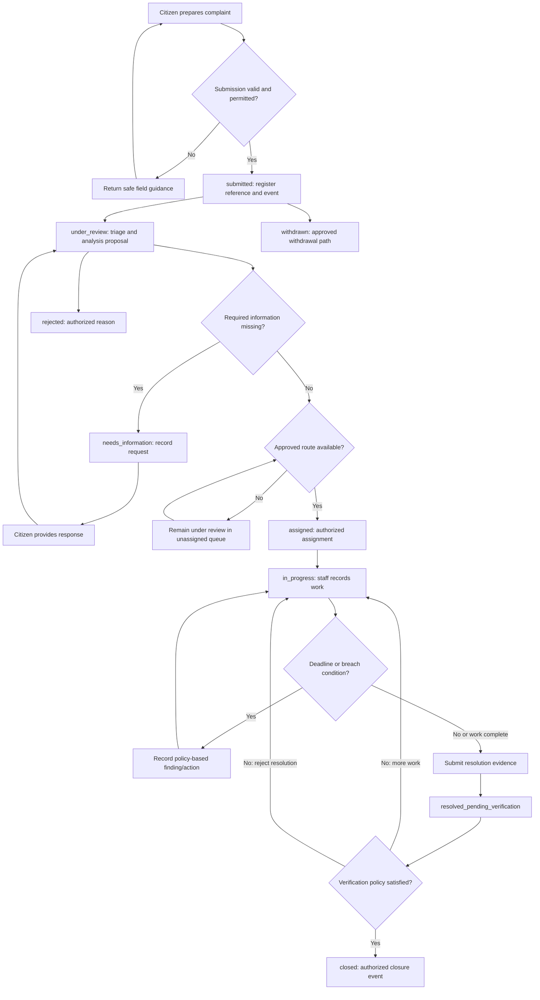

# Complaint lifecycle and state-transition proposal

**Status:** Proposed for product/policy review; not an approved workflow. 
**Related:** [Functional requirements](../requirements/functional-requirements.md), [roles and use cases](../requirements/user-roles-and-use-cases.md), [MVP scope](../requirements/MVP-scope.md)

The state names and rules below provide a concrete starting model. Team Kafka and the relevant authority/policy owner must approve or replace them before implementation. Do not encode these examples as final policy without approval.

## 1. Candidate states

| Candidate state | Meaning | Citizen visibility (proposal) |
|---|---|---|
| `submitted` | Complaint accepted and reference created; initial triage has not completed. | Show receipt and reference. |
| `needs_information` | Specific additional information has been requested and the case is waiting for a response. | Show request, due guidance if approved, and how to respond. |
| `under_review` | Complaint is being checked, classified, or manually triaged; may be unassigned. | Show a plain-language review status. |
| `assigned` | A responsible department/team/officer has accepted or been given the work under policy. | Show department or progress wording approved for public display. |
| `in_progress` | Authorized staff have begun work and may record progress. | Show public-safe status and updates. |
| `resolved_pending_verification` | Staff submitted a proposed resolution and evidence; required verification has not completed. | Explain that resolution is under verification. |
| `closed` | Approved verification policy has been satisfied and closure recorded by an authorized actor/rule. | Show closure outcome, date, and permitted summary. |
| `rejected` | Complaint is not accepted for processing for an approved reason. | Show an approved explanation and any review/appeal route. |
| `withdrawn` | Complaint was withdrawn under an approved policy. | Show withdrawal outcome where appropriate. |

These are not required database enum values. The team must decide whether states such as `queued`, `reopened`, `cancelled`, or `duplicate_linked` are explicit states or events/relationships. A possible duplicate must not cause automatic rejection or merging.

## 2. Proposed lifecycle flow

The loop from “work complete” in the diagram is illustrative. Monitoring and resolution are distinct activities; the exact triggers for returning to work or requesting verification need a transition table approved by policy owners.

## 3. Candidate transition rules

| From → to | Initiator | Proposed preconditions and records | SLA consideration |
|---|---|---|---|
| New → `submitted` | Citizen or allowed intake channel | Input passes validation; reference and initial event commit atomically. | Defines candidate clock start; exact event and timing must be approved. |
| `submitted` → `under_review` | Application rule or authorized triage staff | Record triage start and source; do not require AI availability. | May start a separate triage target if policy defines one. |
| `under_review` → `needs_information` | Authorized staff; AI may suggest only | Record specific request, requester, time, and due guidance if applicable. | Decide whether and when any clock pauses; no implicit pause. |
| `needs_information` → `under_review` | Citizen response or authorized staff | Validate response, attach to case, record response event, resume review. | Resume behavior and late-response handling must be configured. |
| `under_review` → `assigned` | Authorized assignee/supervisor or approved deterministic rule | Destination exists, is eligible and effective; assignment actor/reason and SLA policy reference recorded. | Select applicable approved rule and clock start/reset behavior. |
| `assigned` → `in_progress` | Assigned officer or approved rule | Actor has current assignment/scope; record start/action. | Work clock follows approved policy. |
| `in_progress` → `in_progress` | Authorized staff/system event | Progress event is allowed; distinguish internal note from citizen-visible update. | Event may affect clock only if policy explicitly states so. |
| `in_progress` → `resolved_pending_verification` | Authorized officer | Resolution summary/evidence meets submission requirements; record submitter and evidence references. | Define whether work SLA stops, continues, or changes to verification SLA. |
| `resolved_pending_verification` → `closed` | Authorized verifier or approved policy-driven action | Evidence and required checks pass; any separation-of-duties rule is satisfied; record verifier, time, outcome, and policy version. | Record closure/verification timing as policy requires. |
| `resolved_pending_verification` → `in_progress` | Authorized verifier/supervisor | Verification rejected or more work requested with reason; record disposition. | Define continued or restarted clock behavior. |
| Eligible active state → `rejected` | Authorized staff under approved criteria | Approved reason code and explanation; record actor and any appeal/review route. | Define whether SLA ends and whether audit retention continues. |
| Eligible state → `withdrawn` | Citizen or authorized staff according to policy | Verify requester authority; record request and disposition. | Define clock stop and downstream notification. |
| `closed` → active/reopened path | Authorized actor only, if policy permits | Reopen reason, link to prior closure, preserve history, and notify as allowed. | Define new clock versus continuation and applicable rule version. |

All transitions must re-read the current complaint version/state before commit. Invalid or stale transitions must not silently overwrite newer work.

## 4. Event and audit model

The current state is a convenient projection; the event history is the accountable record of how it changed. For each material transition or privileged action, capture at least:

- complaint reference and event type/version;
- prior and resulting state where applicable;
- actor identity or named system process;
- timestamp and correlation/request ID;
- reason code and safe explanation where required;
- relevant assignment, SLA/policy version, or evidence reference;
- whether the event is citizen-visible, staff-only, or restricted audit data.

Do not place unrestricted complaint text, credentials, or full attachment contents in ordinary logs. Define correction, retention, export, and deletion behavior with policy owners. Corrections should be attributable events, not silent rewrites of history.

## 5. SLA clock model questions

The application should calculate deadlines deterministically from approved rules. An AI agent may flag risk, but it must not create or change a deadline.

Approve the following before implementation:

1. Which event starts each clock: submission, acceptance, assignment, or another point?
2. Which work calendar, timezone, holidays, and business hours apply?
3. Whether a request for information pauses any clock, and which actor/event can pause or resume it.
4. Whether reassignment, reopening, appeal, or resolution verification starts a new clock or continues an existing one.
5. How policy versions/effective dates apply to in-flight complaints and retroactive changes.
6. What constitutes at-risk, due, overdue, and breached; which authorized roles receive each escalation.
7. How data corrections and clock recalculation are audited.

No concrete SLA durations or government policy values are defined in this document.

## 6. Resolution verification and disputes

Before closure, define:

- acceptable evidence types and who may submit or view them;
- whether verification is performed by a different staff member, supervisor, citizen, or combination;
- whether citizen confirmation is required, optional, or time-bounded;
- what happens if the citizen does not respond or disputes the outcome;
- who may reopen or appeal, the time window, and the review path;
- whether resolution verification has its own SLA;
- which closure facts are publicly displayed.

Until these are decided, “closed” is a proposed terminal state only. A model’s claim that an issue is resolved is never sufficient verification.

## 7. Human review and exceptions

Route to a human review queue when an AI result is invalid or uncertain, reference data is missing/conflicting, the requested transition is unauthorized, a case is disputed or sensitive, or policy requires approval. Queue records should identify the reason, owner/scope, age, and next allowed action. If no route is configured, retain the case in an authorized general triage queue rather than inventing an owner.

## 8. Open decisions before implementation

- Approve state names, terminal/reopen states, and transition table.
- Approve which transitions citizens, officers, supervisors, administrators, and automated processes can request.
- Define citizen-visible status/event projection and internal note/evidence handling.
- Define assignment acceptance, transfer, unassigned queue, rejection, withdrawal, duplicate-linking, and appeal behavior.
- Define SLA clock semantics, values, policy source/versioning, and escalation rules.
- Define resolution evidence, verifier authority, separation of duties, citizen confirmation, and closure/reopen policy.
- Define audit record protections, retention, and data correction/deletion requirements.

## 9. Change management

Once approved, record the state machine and policy semantics in an ADR or policy-owned specification, update functional requirements and API/data contracts, and add transition tests before coding the full workflow. Any later policy change must identify effective date, in-flight case handling, migration/backfill need, and audit implications.
