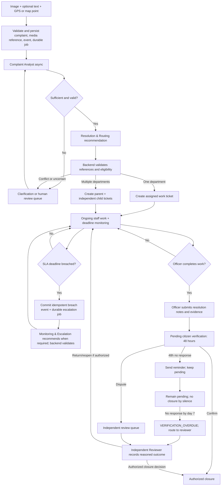

# Complaint lifecycle and state-machine proposal

**Status:** Target workflow. Anonymous tracking and the seven-calendar-day overdue-review path are intended project policies. Role grants, normalized state names, daylight-saving ambiguity handling, reviewer authority mapping, and production operations require detail before implementation. 
**Related:** [Functional requirements](../requirements/functional-requirements.md), [roles and use cases](../requirements/user-roles-and-use-cases.md), [MVP scope](../requirements/MVP-scope.md), [master blueprint](implementation-blueprint.md)

This page describes the target workflow, not a claim about current implementation or statutory municipal authority. State names and implementation details require approval. The project baseline requires citizen confirm/dispute after resolution evidence, a reminder at 48 hours without response, and no closure by silence. Application code alone authorizes and persists transitions; an agent recommendation is never a transition.

## Complaint/ticket states

| State | Meaning |
|---|---|
| `SUBMITTED` | Image-first complaint persisted; analysis job is pending or queued. |
| `PROCESSING` | Analysis/routing workflow is running asynchronously. |
| `NEEDS_INFORMATION` | Required clarification has been requested. |
| `PENDING_REVIEW` | Human review is needed for uncertainty, missing/conflicting references, location, or routing. |
| `READY_FOR_ROUTING` | Analysis is sufficiently complete for routing validation. |
| `ASSIGNED` | A validated department/officer assignment exists. |
| `IN_PROGRESS` | Authorized staff are working and recording progress. |
| `RESOLVED_PENDING_VERIFICATION` | Officer submitted resolution details/evidence; citizen verification is pending. |
| `DISPUTED` | Citizen disputed the proposed resolution. |
| `PENDING_AUDIT_REVIEW` | Independent reviewer must decide a dispute or authorized exception. |
| `VERIFICATION_OVERDUE` | No citizen response by the intended seven-calendar-day deadline from verification start; route to the Independent Reviewer. This transition does not close the case. |
| `CLOSED` | Approved verification/closure requirements are satisfied. |
| `CANCELLED` | Ticket ended through an explicitly permitted, audited cancellation. |

These are proposed normalized names. `RESOLVED_PENDING_VERIFICATION` is the normalized form of the blueprint's semantic `Pending_Citizen_Verification`; `VERIFICATION_OVERDUE` represents the intended Samadhan AI policy after seven calendar days without response. These are not claims about universal municipal rules. Keep SLA state separate. Rejection, reopening, and appeal semantics need explicit policy decisions; do not add ad hoc transitions.

## Main flow

## Parent and child behavior

- The citizen's parent complaint represents the overall report. Department-specific child tickets are independent work items.
- Every child has its own assignment, state/history, evidence, rejection/reassignment history, escalation and SLA clock.
- Parent progress is an aggregation of child states; it must not overwrite their status or imply work is complete when it is not.
- Normal parent closure requires every child to complete its required verification workflow. A separately authorized senior exception requires a reason and audit event, and must not mark or hide unresolved children.
- Department rejection requires a reason. Repeated rejection or unresolved jurisdiction conflict goes to human review instead of an uncontrolled routing loop.

## SLA processing and escalation

1. Apply an effective-dated, configured SLA policy and persist its version and deadline for each child ticket.
2. A deterministic scheduled worker queries due records in indexed batches, safely claims work, and rechecks current ticket state/deadline.
3. In one database transaction, persist the breach outcome, its `SLA_BREACHED` business event, and durable escalation job intent when escalation processing is required. An idempotency uniqueness rule prevents repeated evaluation of the same logical breach from creating duplicate events/jobs; the job tracks attempts and recovery after downtime. Duplicate processing must not create duplicate logical breaches or escalations.
4. Invoke Monitoring & Escalation only when a valid breach/escalation event needs reasoning. The agent summarizes history and recommends the next authority; backend validates policy, authority, and action before persisting or notifying.
5. Optional warnings use deterministic rules. No LLM continuously polls deadlines or calculates timestamp comparisons.

SLA values, calendars, pause/resume semantics, scheduler, claim mechanism, and deployment guarantees remain open. Sample policies are demonstration-only and must be labelled.

## Resolution verification

Officer submission is a proposal, not closure. The backend stores required category-appropriate evidence, starts the 48-hour citizen decision period, records its deadline, and sends the citizen a notification and proof card with confirm/dispute actions. Citizen confirmation triggers the authorized normal closure transition; a dispute enters the assigned Independent Reviewer queue. At 48 hours without response, send a reminder and keep the case pending. Silence never counts as confirmation.

**Intended overdue path:** if no response has been received by seven calendar days from verification start, transition the case to `VERIFICATION_OVERDUE` and route it to the Independent Reviewer queue. The reviewer examines evidence and history, records a reasoned outcome, and may approve closure only when explicitly authorized or return/reopen the work when authorized. Missing citizen response alone is never proof of resolution. The 7-day threshold is a Samadhan AI design policy, not a universal municipal rule. A late citizen response is recorded. Before reviewer assignment, process it through ordinary verification rules after checking current state and authorization. Once review is queued or assigned, preserve the response and show it to the reviewer; it must not automatically close the complaint or cancel active review. A late dispute does not automatically reprioritize the review; it is recorded as new input for the reviewer. Serialize responses, reviewer assignment/reassignment, and decisions using a transaction and row lock or version check. Record review outcome, actor, timestamp, reason, and authorized resulting transition. Backend transition guards enforce these rules.

For composite complaints, citizen verification is tracked per child/work ticket; parent progress is derived from its children. Normal parent closure requires every applicable child workflow to complete. An exceptional parent closure requires a specifically authorized Senior Authority, reason, and audit event; it cannot change or hide unresolved child states. The Independent Reviewer role does not imply Senior Authority permissions.

## Event and audit invariants

For each material action record actor/system, action, target, time, prior/resulting state, reason/reference, request/correlation ID, visibility, and applicable policy/version. Preserve model proposal and reviewer disposition separately. State changes and required events commit atomically. Assign each repeatable business-event producer a stable key for one logical operation and enforce uniqueness within its complaint/event-type scope; exact key construction and retention are physical-schema decisions. A duplicate-key conflict means the logical event already exists and must not be emitted again. Job retries use separate job identity/attempt state and must not create another business event. Consumers and handlers remain idempotent because work may be delivered or executed more than once. Stale work cannot overwrite newer state. Operational logs must not contain raw images, credentials, or unnecessary personal data.

## Decisions before production

Approve role grants and normalized state transitions; category/department/jurisdiction data; SLA values/calendar; evidence standards; reviewer mapping/outcomes; parent exception authority; correction/retention/deletion; and event/job recovery behavior. The intended seven-calendar-day review path and late-response default are documented; before implementation, decide real-world reviewer authority/mapping and the jurisdiction's daylight-saving ambiguity rule. Recommended deadline semantics: reminder due exactly 48 elapsed hours after verification starts; derive the seven-day local deadline at the same wall-clock time seven dates later in the complaint jurisdiction's configured IANA timezone; preserve timezone context and store due instants in UTC; treat the overdue deadline as inclusive (`now >= deadline`); and process missed deadlines after downtime. A missing timezone must be surfaced, never inferred from a device; keep the complaint pending and revalidate current state before overdue transition/reviewer assignment. Update this contract and its API/data model whenever approved decisions change.
