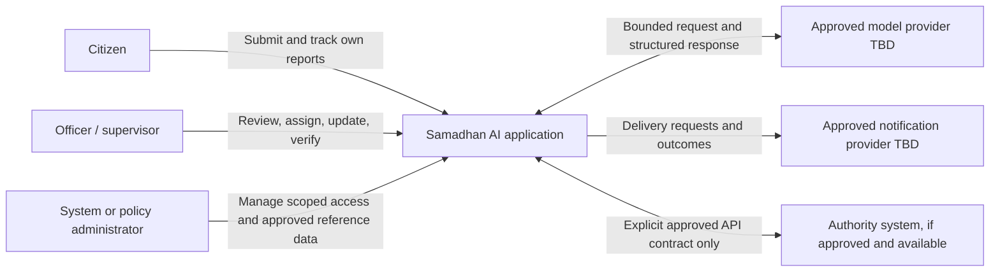
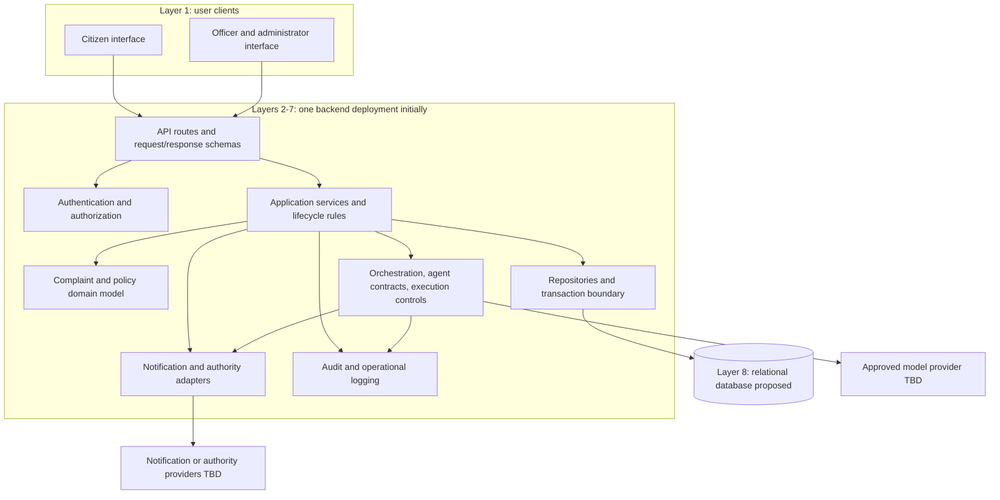

# Samadhan AI system architecture

**Status:** Proposed; pending Team Kafka approval 
**Scope:** Logical architecture and initial deployment shape. This is not an as-built diagram; only the first complaint intake/tracking backend slice has been scaffolded.

## 1. Architecture goals

- Support the MVP complaint lifecycle as one understandable, auditable system.
- Keep policy, permissions, and state transitions under application control.
- Let AI analyze and recommend through versioned, validated interfaces.
- Keep external providers replaceable and failure-contained.
- Preserve the option to scale or separate components when actual workload or ownership needs justify it.

## 2. System context

The model, notification provider, and authority system are possible external dependencies, not confirmed integrations. There is no evidence that an authority API or sandbox is available. The reference presentation was not found during the workspace audit; this view is based on the supplied project brief.

## 3. Proposed eight-layer architecture

These are logical responsibilities. They do not require eight processes, repositories, or separately deployed services.

| Layer | Responsibility | Initial placement | Boundary and controls |
|---|---|---|---|
| 1. User layer | Citizen application, officer dashboard, administrator dashboard | Frontend client(s), implementation stack pending | Treat all client input as untrusted; render only API-authorized fields. Frontend language proposal is JavaScript unless team explicitly changes it. |
| 2. API and security | HTTP API, authentication, authorization/RBAC, input validation, throttling, safe errors | Backend API module | Enforce identity, resource scope, and action permission for every request; never rely on UI restrictions. |
| 3. AI orchestration | Workflow state, handoff, bounded retries/timeouts, review pause/resume, failure recovery | Backend AI module initially | Coordinates agent interfaces but cannot override domain policies. LangGraph remains proposed pending need/approval. |
| 4. AI agents | Complaint Analyst, Resolution and Routing, Monitoring and Escalation | Agent implementations behind internal interfaces initially | Return typed recommendations. No direct database writes, unrestricted tools, or invented policy data. |
| 5. Agent harness / execution control | Shared invocation context, tool registry, permissions, schemas, guardrails, budgets, logs, review gates | Backend AI module/library initially | Allowlisted typed tools, minimal context, output validation, correlation/audit, explicit human review. |
| 6. Context and knowledge | Approved policies, department/jurisdiction references, SLA rules, procedures; retrieval where justified | Application services and relational reference data initially | Authoritative policy sources and versions required. RAG/vector search is optional; no pgvector decision yet. |
| 7. Agentic tools and integration | Notifications, authority-system adapters, optional MCP integrations | Backend adapter modules; separate worker only if justified | Explicit allowlist, scoped credentials, destination control, timeout, retry, idempotency, and normalized failure outcomes. MCP is optional, not needed for internal method calls. |
| 8. Data | Users, complaints, assignments, policy/reference records, events/audit, notifications, AI runs, knowledge metadata | One transactional relational database proposed | PostgreSQL is proposed but not approved/installed. Database access stays behind application persistence boundaries. Vector storage is not assumed. |

## 4. Initial component/container view

The diagram shows logical calls, not a finalized technology or process topology. In particular, whether notification dispatch and scheduled monitoring run inline or through a background worker remains open.

## 5. Core request and data flows

### Complaint submission

1. Client sends a request over the approved authenticated or anonymous access path.
2. API validates syntax and delegates to a complaint application service.
3. Service applies domain rules, creates the complaint and initial event in a transaction, and generates a public reference.
4. Optional analysis is invoked with the minimum approved context. Its result is schema-validated and stored as a proposal/run record.
5. Service returns only the permitted acknowledgement fields. Notification attempts are tracked separately from the authoritative complaint transaction.

### Routing and assignment

1. Service assembles validated complaint facts and approved, versioned reference data.
2. Routing component proposes eligible destinations and policy references.
3. Application verifies that each reference exists, is effective, and is allowed for the complaint and acting workflow.
4. Authorized staff confirm or edit the proposed assignment, or the case enters an unassigned review queue.
5. Assignment, policy reference, actor, reason, and resulting lifecycle event are persisted together.

### Monitoring and closure

1. A scheduler or operator-triggered process evaluates current complaint timestamps against approved SLA rules.
2. Monitoring produces a finding or action proposal; application checks policy and authorization.
3. Escalation and notification intents/results are recorded with safe retry semantics.
4. Officer submits resolution evidence; verification policy determines whether an authorized reviewer or citizen input is required.
5. Only an allowed transition closes the complaint; event history and citizen notification reflect the actual decision.

## 6. Agent interaction and human review

The Complaint Analyst produces structured observations and uncertainty. The Resolution and Routing Agent can use only approved data to propose a destination and SLA reference. The Monitoring and Escalation Agent evaluates due-state facts and suggests permitted actions. The application orchestrates these interfaces and remains the authority for authorization, persistence, transition rules, and side effects.

Human review is required whenever policy says so, inputs are ambiguous, reference data is missing or conflicting, output fails validation, confidence is outside an approved range, or an action is sensitive. The review queue must be an ordinary supported operational path, not merely a prompt instruction. For detailed contracts, see [AI agent architecture](ai-agent-architecture.md).

## 7. Trust and security boundaries

- **Client boundary:** browser/session and submitted data are untrusted; validate input and authorize every resource/action at the server.
- **AI provider boundary:** send minimum necessary context; treat output as untrusted; validate schema and references; define provider retention, training, and data-region terms before selection.
- **Integration boundary:** allowlist destinations and operations; use scoped credentials; validate responses; enforce timeouts, retries, and idempotency.
- **Persistence boundary:** application services own transactions and domain invariants; agents cannot use unrestricted SQL or database credentials.
- **Administrative boundary:** configuration and policy changes require specific permissions, provenance, versioning, and audit. See [security design](../security/security-design.md).

## 8. Initial deployment topology

**Proposal:** one backend application deployment, one relational database, and one frontend deployment. External model/notification/authority providers are connected only after selection and approval. Local development can begin with a developer-managed database once the stack is chosen. Avoid committing database dumps, real credentials, or citizen data.

A background worker/scheduler may be added when asynchronous analysis, reliable deadline monitoring, or notification delivery needs prove it is necessary. If added, it should reuse application services and authorization rules, and use a durable job/outbox design appropriate to the selected database and deployment. A message broker, cache, vector database, Kubernetes, or service-per-layer topology has no documented requirement yet.

## 9. Evolution and decision points

Revisit deployment boundaries only when measured traffic, reliability isolation, independent ownership, security isolation, or provider constraints justify them. Review ADR-001 for technology selection and ADR-002 for the modular-monolith proposal. Before implementation, agree on identity, role scopes, lifecycle, authoritative policy data, SLA semantics, human review rules, provider data handling, and operations targets.

## 10. Limitations

This document is proposed architecture, not a diagram of deployed components. No framework, database, model, notification channel, external integration, hosting platform, or service-level objective has been verified or finalized. The project presentation must be made available before claiming its diagrams or future-scope details were reviewed.
