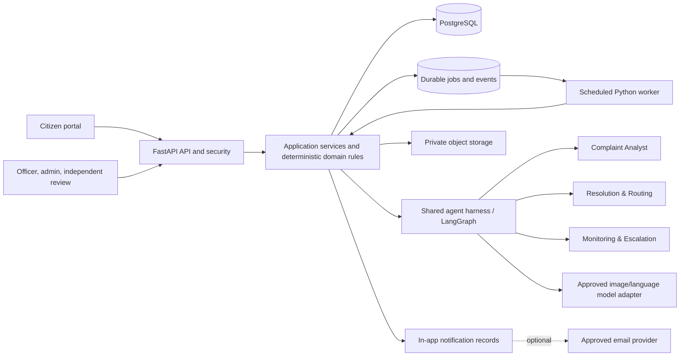

# Samadhan AI system architecture

**Status:** Target architecture aligned to the supplied blueprint; not an as-built diagram. 
**Implementation status:** Only a preliminary text-based citizen intake/tracking slice exists. See [backend README](../../backend/README.md). 
**Master reference:** [Implementation blueprint](implementation-blueprint.md)

## Architecture principle

AI-assisted interpretation with deterministic operational control and human accountability. Keep the initial deployment a modular monolith: FastAPI API, application/domain services, three-agent orchestration/harness, PostgreSQL persistence, and a scheduled Python worker as deployment allows. Do not make the logical layers separate services by default.

## Logical architecture

| Layer | Responsibilities | Target technology direction |
|---|---|---|
| User interfaces | Citizen portal; officer dashboard; admin/independent-review dashboard | React with JavaScript |
| API/security | API, OpenAPI, Pydantic validation, JWT, RBAC and department/jurisdiction scope, rate limits, controlled uploads | FastAPI, Pydantic |
| Application/domain | Authorization, state machine, ticket parent/child behavior, assignment, SLA policies, transactions, audit and notifications | Python modular application; SQLAlchemy |
| Agent orchestration | Durable async workflow and human review/handoffs for exactly three agents | LangGraph target; PostgreSQL persistence where appropriate |
| Agent harness | Typed schemas/tools, permissions, budgets, timeout/retry, guardrails, run records | Shared constrained application component |
| Context and policy | Departments, wards, jurisdiction rules, SLA/escalation hierarchy, resolution policy and source metadata | PostgreSQL; pgvector for approved policy retrieval |
| Integrations | Private image/evidence object storage, model adapter, in-app notifications, optional email/MCP or municipal adapters | Provider interfaces; scoped credentials |
| Persistence and operations | Complaints, child tickets, events, jobs, assignments, SLAs, notifications, audit, agent runs, recovery | PostgreSQL plus scheduled worker; durable jobs/events |

Technology table reflects recommendations in the supplied blueprint. Concrete versions, hosting, providers, object storage, scheduler/job claiming, and notification channels remain to be chosen and verified. PostgreSQL/pgvector and LangGraph are target recommendations; do not claim integration until implemented.

## Container view

The database is not itself a scheduler. Job state and SLA processing must survive process restarts; a free hosting plan that sleeps cannot promise continuous monitoring, so overdue work must be recovered and deployment claims must match actual platform behavior.

## Core data flows

### Submission and analysis

1. Frontend collects a required image, optional text, and location through explicit GPS permission or manual map selection.
2. API validates decoded image content, dimensions/limits, request fields, and access policy; safely normalizes media and stores it privately.
3. In a durable transaction/workflow, persist complaint, media reference, initial event, and analysis job before calling a model. Return a reference and initial processing state.
4. Complaint Analyst asynchronously returns structured, grounded findings. Validate them and store agent/model/schema provenance. AI errors leave complaint available for retry or human review.
5. If location is absent/uncertain, preserve the report for location review. Resolve jurisdiction from configured boundaries, never from the image.

### Routing and composite work

1. Resolution & Routing receives validated analysis and approved, versioned department/jurisdiction/officer/SLA references.
2. It proposes one or more assignments and a policy reference; deterministic application checks eligibility, effective dates, workload constraints and current complaint version.
3. Create one assigned ticket or a parent with independent child tickets for multiple departments. Conflict, missing reference, or uncertainty enters human review. Rejection requires a reason and repeated conflicts cannot bounce indefinitely.

### SLA, escalation, resolution

1. Persist each child ticket's effective SLA policy/version and deadline.
2. Scheduled deterministic worker claims due records in indexed batches, rechecks state/deadline, and writes idempotent warning/breach events. It recovers overdue work after downtime; no per-ticket LLM polling.
3. A valid escalation event can invoke Monitoring & Escalation. Backend checks the recommended authority/action before persisting and notifying.
4. Officer submits category-appropriate resolution evidence; the citizen is notified and receives a proof card with confirm/dispute actions. Confirmation triggers authorized normal closure; a dispute enters the assigned Independent Reviewer queue. At 48 hours without response, send a reminder and keep pending; silence is never confirmation. Under the intended project policy, no response within seven calendar days routes the case to an Independent Reviewer for a reasoned decision; deadline timezone and recovery details are specified in the lifecycle/schema plan. Parent completion reflects child verification. Exceptional parent closure requires a separately authorized Senior Authority and audit event.

### Policy retrieval (RAG)

1. Use source-linked policies for department responsibility, ward/jurisdiction mapping, category routing, SLA references, escalation hierarchy, and evidence requirements. Initial sample policies must be labelled demonstration-only, not official municipal policy.
2. Retrieve relevant policy chunks from PostgreSQL/pgvector and filter by jurisdiction, department, effective date, and policy version.
3. Give agents the minimum relevant snippets with source/version metadata; require structured recommendations that cite the supporting references.
4. Backend verifies the references and all authorization, state, eligibility, and SLA rules deterministically. Retrieval informs a recommendation; it does not replace policy validation.

## Trust and failure boundaries

- Client input, images, retrieved policies, providers, and all model output are untrusted.
- Model context is minimized; no real images are sent until provider/data terms are approved.
- Agents have typed allowlisted tools and no direct database writes, arbitrary SQL, shell, or unrestricted network access.
- Application code owns authorization, state transitions, assignment, SLA calculations, and external side-effect intent.
- Provider, storage, worker, or notification failure must be visible and retry-safe without corrupting the authoritative complaint state.
- See [AI agent contracts](ai-agent-architecture.md), [security design](../security/security-design.md), and [lifecycle](complaint-lifecycle.md).

## Open architecture decisions

Approve the identity and anonymous tracking scheme; policies and official reference sources; object storage/scanning/retention; model/provider and data region; LangGraph persistence; worker scheduler/claim mechanism and hosting guarantees; notification channels; and production SLO, backup, RPO/RTO, and support ownership. Avoid extra infrastructure until deployment evidence warrants it.
