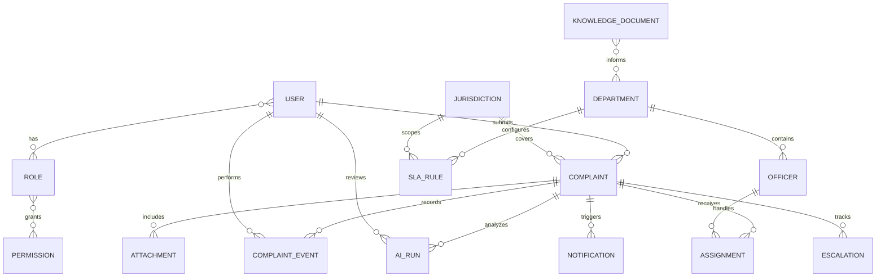

# Conceptual data model

**Status:** Proposed domain model; not a physical schema. 
**Database/tooling:** PostgreSQL is proposed by the project brief; no database, ORM, or migration tool is selected or installed.

This model captures the information concepts required by the MVP. Names, exact relationships, cardinality, fields, identifiers, and retention behavior require team/policy review before schema design. Avoid turning this diagram directly into tables without resolving the decisions below.

## 1. Relationship overview

The diagram is conceptual. Actor references may include named system processes, and some links may be nullable depending on anonymous intake, system-generated events, and policy decisions.

## 2. Entity purpose and important relationships

| Concept | Purpose | Relationships and design notes |
|---|---|---|
| **User** | Represents a citizen, officer, supervisor, administrator, or other approved actor. | May submit complaints and perform events. Identity provider, anonymous-user representation, profile fields, and separation from Officer profile are TBD. Minimize personal data. |
| **Role** | Groups capabilities assigned to users. | User-to-role may be many-to-many; scoped grants may need department/jurisdiction context and effective dates. Decide whether roles/permissions are managed records or a simpler code policy. |
| **Permission** | Names an allowed action/capability. | May map to roles or direct scoped grants. Avoid overengineering a general policy engine before access rules are known. |
| **Complaint** | Central record describing a reported civic issue and current lifecycle projection. | Submitted by a User when known; has a public reference, state, jurisdiction association, assignments, events, evidence, notifications, escalations, and AI runs. Keep internal ID distinct from public reference. |
| **Attachment** | Metadata and protected reference to uploaded evidence. | Belongs to a complaint; may need uploader, scan state, media type, size, storage key, and retention metadata. Store bytes in an approved protected object store if selected; do not expose raw storage paths. Attachment support is conditional on controls. |
| **Department** | Approved organizational routing unit. | May have hierarchy, active/effective dates, jurisdictions, officers, and policy links. Authoritative source and hierarchy are TBD. |
| **Jurisdiction** | Geographic or service boundary used to determine responsibility. | May relate to complaints, departments, and SLA/routing rules. Decide representation and source; do not assume geospatial extension is needed. |
| **Officer** | Staff-specific profile and assignment eligibility. | Usually linked to User identity and one or more departments/jurisdictions; may have active dates and team membership. Keep employment/contact data minimal. |
| **Assignment** | Historical record of routing, assignment, transfer, and unassignment. | Links complaint to officer, team, or department and records actor/time/reason. Preserve prior assignment; current assignment can be derived or projected. Destination model is TBD. |
| **SLA rule** | Approved, versioned target and clock policy. | Scope may include category, severity, department, jurisdiction, and effective period. Define precedence, calendar, pause/resume, and in-flight policy change behavior. AI may reference but never create/change values. |
| **Complaint event / transition** | Durable history of important state changes and actions. | Links complaint to actor/system, prior/resulting state, timestamp, reason, policy reference, and visibility classification. Distinguish citizen-visible timeline from restricted audit events. |
| **Notification** | Intended communication and delivery outcome. | Links complaint/event to recipient/channel/template and one or more attempts. May need idempotency key, provider reference, failure reason, and safe content reference. Do not duplicate all sensitive complaint data in notification rows. |
| **Escalation** | Tracks risk/breach finding, policy basis, owner, review, and action. | Links complaint to an SLA/policy version and may reference notifications/actions. Separate proposal from authorized action and record disposition. |
| **AI run / agent execution** | Records an agent invocation and review disposition. | Links to complaint and agent/schema/model versions; should reference minimized input/output, validation status, time/cost, policy/reference versions, and human reviewer where applicable. Retention and redaction required. |
| **Knowledge document** | Approved department policy/procedure content for optional retrieval. | Has owner, source, version/effective date, classification, review status, and optional index/chunk/embedding metadata. RAG/vector support is deferred until an approved knowledge use case exists. |

## 3. Data ownership and sources of truth

The application should have an authoritative source for each mutable reference set. Candidate responsibilities:

- Identity attributes and authentication status: approved identity provider or minimal local account store (TBD).
- Staff-to-department/jurisdiction eligibility: approved organizational source (TBD).
- Department and jurisdiction definitions: authority/team-managed approved reference source (TBD).
- Category taxonomy and SLA/escalation rules: named policy owner with version/effective-date control (TBD).
- Complaint state and event history: Samadhan AI application, subject to authorized correction and retention rules.
- Model output: proposal/provenance only; never a policy source of truth.
- Notification delivery state: provider outcome normalized and recorded by the application; provider is not the complaint state source of truth.

Do not assume external government systems exist, are accessible, or are authoritative until confirmed.

## 4. Data integrity principles

- Enforce unique public complaint references and required invariants with database constraints where appropriate.
- Persist complaint state changes and required event records atomically.
- Preserve assignment and policy-version history rather than silently overwriting prior decisions.
- Use foreign keys or equivalent integrity checks for approved reference IDs; unknown AI-proposed IDs are rejected or queued.
- Make repeated client/provider operations idempotent where duplicate effects are harmful.
- Define concurrency/version checks for state updates.
- Keep durable business events/audit separate from high-volume debug logs.
- Apply data retention, deletion, correction, and legal-hold policy across primary records, attachments, logs, exports, AI runs, backups, and indexes.

## 5. Privacy and security considerations

- Classify each field by purpose and visibility before schema design. Separate citizen-visible details, staff-only notes, and restricted security/audit data.
- Use opaque public references and avoid sequential internal IDs in public routes.
- Protect attachment storage and require authorization on every retrieval.
- Do not embed personal data in vector indexes unless approved; define deletion propagation if retrieval indexing is introduced.
- Restrict AI-run access; redact/minimize inputs and outputs; decide if raw prompt/response retention is necessary or prohibited.
- Ensure every administrative and staff access path obeys object scope and is auditable as policy requires.

## 6. Physical design topics to decide later

After domain and access policies are approved, select:

- Database/version, ORM, driver, migration tooling, and supported environments.
- Internal/public identifier formats, indexes, uniqueness, foreign keys, and delete behavior.
- State projection versus event history strategy and audit immutability level.
- User/role/permission schema and scope/effective-date representation.
- Department/jurisdiction hierarchy and geometry needs.
- Attachment/object storage and scanning integration.
- SLA matching/preference rules and effective-dated policy version model.
- Notification attempt history and outbox/job mechanism if reliable async delivery is required.
- AI run retention, provider metadata, evaluation artifacts, and privacy controls.
- Backup, restore, archival, retention, and deletion behavior.
- Whether pgvector/RAG is required; no vector store is assumed for MVP.

## 7. Open questions before implementation

1. Who owns each reference dataset, and how are changes reviewed and imported?
2. Are anonymous complaints supported? If yes, how is access, abuse prevention, and identity association represented?
3. Are officer and user separate concepts? Can staff belong to multiple teams/departments/jurisdictions with effective dates?
4. Which events are business timeline events, restricted audit events, or operational logs?
5. What records must be retained, corrected, deleted, anonymized, or held, and for how long?
6. Does the system need geographic queries or only a jurisdiction reference ID in MVP?
7. What attachment, notification, and AI-run data is persisted, and who can see it?
8. How do policy changes affect complaints already in progress?

## 8. Change management

When the team approves conceptual entities and ownership, create the physical schema and data dictionary alongside initial migrations. Every schema change must include migration and rollback/forward-fix considerations, constraint and authorization implications, test coverage, and updates to the API/data docs. Never use this conceptual document alone as implementation authorization for unapproved policy fields.
