# Conceptual data model

**Status:** Target logical model aligned to the supplied blueprint; not the current physical schema. 
**Target database:** PostgreSQL, with pgvector for approved policy retrieval. Concrete database/version and physical constraints require review. 
**Master reference:** [Implementation blueprint](../architecture/implementation-blueprint.md)

The current physical schema has `complaints` and `complaint_events` tables, with migrations through `0002_event_correlation_id`. The target entities below are a design aid; they are not evidence that the target workflow tables or constraints exist. Relationship notation describes logical cardinality; selected physical details are recorded in the readiness assessment below.

## Relationship overview

```mermaid
erDiagram
  USER }o--o{ ROLE : grants
  USER o|--o{ COMPLAINT : submits
  COMPLAINT ||--o{ COMPLAINT_MEDIA : includes
  COMPLAINT o|--o{ COMPLAINT : parent_of
  COMPLAINT ||--o{ COMPLAINT_ANALYSIS : analyzed_by
  COMPLAINT ||--o{ ASSIGNMENT : receives
  DEPARTMENT ||--o{ ASSIGNMENT : destination
  OFFICER o|--o{ ASSIGNMENT : individual_assignee
  DEPARTMENT ||--o{ OFFICER : employs
  WARD ||--o{ OFFICER : scopes
  COMPLAINT ||--o{ COMPLAINT_SLA : tracks
  SLA_POLICY ||--o{ COMPLAINT_SLA : defines
  COMPLAINT ||--o{ COMPLAINT_EVENT : records
  COMPLAINT ||--o{ ESCALATION_RECORD : escalates
  COMPLAINT ||--o{ RESOLUTION_SUBMISSION : resolves
  RESOLUTION_SUBMISSION ||--o{ RESOLUTION_EVIDENCE : includes
  COMPLAINT_MEDIA ||--o{ RESOLUTION_EVIDENCE : referenced_by
  RESOLUTION_SUBMISSION ||--o{ CITIZEN_VERIFICATION : receives
  COMPLAINT ||--o{ INDEPENDENT_REVIEW : reviewed_in
  COMPLAINT o|--o{ NOTIFICATION : concerns
  NOTIFICATION ||--o{ NOTIFICATION_ATTEMPT : attempts
  BACKGROUND_JOB o|--o{ NOTIFICATION_ATTEMPT : initiates
  COMPLAINT o|--o{ AUDIT_LOG : optionally_references
  USER o|--o{ AUDIT_LOG : acts
  COMPLAINT ||--o{ AGENT_RUN : analyzed_by
  KNOWLEDGE_DOCUMENT ||--o{ KNOWLEDGE_CHUNK : contains
  COMPLAINT o|--o{ BACKGROUND_JOB : optionally_traces
```

The diagram omits generic job/audit target references: `target_type`/`target_id` and `entity_type`/`entity_id` are application-level polymorphic references, not ordinary foreign keys. See the entity definitions and integrity notes below.

## Target entities

| Entity | Purpose and important fields/relationships |
|---|---|
| `users`, `roles` | Citizen/staff identity and scoped capabilities. Optional `password_hash` only if local passwords are used. Role grants must be attributable and effective-dated where needed. |
| `departments`, `wards` / jurisdiction rules, `officers` | Approved responsibility and eligibility data. Officers link to users, departments and authorized jurisdictions; authoritative source and boundary representation remain TBD. |
| `complaints` | Parent or work ticket: public tracking reference, nullable `user_id` FK to `users` for authenticated submissions, optional `parent_id` self-FK, description, category/priority, location coordinates/accuracy/source/time, resolved ward, status and timestamps. Parent and work tickets must be distinguishable. For anonymous access, store a credential verifier and key-version identifier, never the raw tracking token or HMAC key. Use a cryptographically secure random token and a versioned server-key HMAC (or security-reviewed equivalent); compare verifiers in constant time. A null `user_id` never grants access. |
| `complaint_media` | Private object key, media type, purpose, uploader, size/integrity/scan metadata, owning complaint and creation time. Never store unrestricted public URLs. Evidence policy decides whether original, normalized copy, or both are retained. This table represents stored files; resolution evidence links to these rows rather than duplicating file metadata. |
| `complaint_analysis` | Versioned analyst result: provider/model, generated description, category/priority recommendation, evidence/uncertainty/missing fields, review flag and timestamp. Preserve the proposal separately from applied decisions. |
| `assignments` | Each history row belongs to exactly one complaint/work ticket and one department. `officer_id` may be null for a queued/unassigned department record, but must be non-null for an active assignment. Record actor/source, time, status, mandatory rejection reason and reassignment link/history; reassignment creates a new row and preserves the prior row. A complaint/child may have many assignment-history rows; an officer or department may appear on many rows. A complaint is unassigned when it has no active assignment. |
| `sla_policies`, `complaint_sla` | Effective/versioned policy keyed as required by category, priority and jurisdiction; each work child gets its own start/deadline/status/breach and policy snapshot/reference. SLA status is separate from complaint status: `NOT_STARTED`, `ACTIVE`, `WARNING_SENT`, `BREACHED`, policy-permitted `PAUSED`, `COMPLETED`, or validly superseded `CANCELLED`. Parent does not replace child clocks. |
| `complaint_events` | Append-oriented business events for the complaint timeline: actor/system attribution, event/action, prior/resulting state, safe context/reason, visibility, occurred time, correlation ID and a stable producer-supplied idempotency key for repeatable event creation. Recommend a database uniqueness constraint on `(complaint_id, event_type, idempotency_key)`. This is not the owner of worker attempts, locks, retry timing, or delivery state. |
| `escalation_records` | Breach event/policy, from/to authority, reason, proposal versus authorized decision, status and timestamps. The deterministic worker detects breaches; Monitoring & Escalation is invoked only when a valid event needs AI reasoning. |
| `resolution_submissions` | One officer's proposed resolution for a complaint/work child, with submitting actor, notes, evidence summary and submission time. It starts citizen verification but does not itself close the complaint. |
| `resolution_evidence` | Association between a `resolution_submission` and an existing `complaint_media` row; include evidence category/type and attachment time as needed. A media item may be linked to multiple submissions only if policy allows; default to no reuse. Validate that the media and submission belong to the same complaint/work child. Evidence records are not silently deleted; retention/deletion follows approved policy and preserves required audit history. |
| `citizen_verification` | Decision records associated with a resolution submission: verification start time, 48-hour reminder due time/status, intended seven-calendar-day reviewer handoff deadline/status, citizen confirm/dispute decision, comment and time. At 48 hours without response, send a reminder and keep pending; at seven calendar days without response, mark overdue and enqueue reviewer assignment. Silence never closes the case. Preserve decision history rather than overwrite it. |
| `independent_reviews` | Review case linked to complaint and trigger (`DISPUTE` or `VERIFICATION_OVERDUE`), assigned reviewer, status, evidence references, reasoned outcome, decision actor/time and audit/event references. Prevent the original officer from acting as the sole reviewer of their resolution. Reviewer closure/return transitions are capability-gated and revalidate current complaint state. |
| `notifications` | One logical notification intent: recipient reference, optional complaint/source-event context, channel/template/version, idempotency identity, status and timestamps. Recommend uniqueness by source event, recipient, channel and template/version for event-triggered notifications. |
| `notification_attempts` | One record per actual delivery attempt, linked to exactly one notification and optionally to the background job that initiated it. Record attempt number, provider, started/completed timestamps, outcome (`DELIVERED`, `FAILED_RETRYABLE`, `FAILED_PERMANENT`, `UNKNOWN`), sanitized failure code/detail and provider request/reference ID where safe. A notification has zero or many attempts. The attempt table records outcomes; the background job owns scheduling, claims, retries and terminal execution state. |
| `audit_logs` | Protected audit of privileged actions and material changes, including actions about complaints, users/roles, policies and reference data. Suggested fields include nullable actor/user FK, system actor identity when applicable, `entity_type`, `entity_id`, optional complaint FK, action, outcome, reason, time and minimized safe metadata. |
| `agent_runs` | Exactly three agent names, workflow/run ID, model/schema version, status, timing, safe error and minimized provenance, plus reviewer disposition where applicable. |
| `knowledge_documents`, `knowledge_chunks` | Approved, source-linked, versioned/effective policy material and optional embeddings via pgvector. Retrieved content includes jurisdiction/department/effective metadata. |
| `background_jobs` | Small durable work queue: work type, `target_type`/`target_id`, optional `complaint_id` FK for complaint tracing, optional source business-event reference where event-triggered, status, available/run-after time, attempt count, retry time, safe failure code/detail, job idempotency key, claim/lease owner and expiry, created/updated/started/completed timestamps. It owns execution, locking/claiming, retry and terminal-failure state—not business-event uniqueness, notification-attempt outcomes, the complaint timeline or authoritative complaint status. Recommend uniqueness for `(work_type, source_event_id)` when a job is caused by a business event, plus a job idempotency key for other repeatable creation paths. |

## Relationship, integrity, and privacy rules

- A complaint has zero or one authenticated submitter (`complaints.user_id` nullable); a user can submit zero or many complaints. Anonymous submission and tracking are supported project policy. Generate a cryptographically secure high-entropy token and return it only through the protected creation/renewal response; store only its HMAC verifier and key identifier/version. Keep token and HMAC key out of logs, audit payloads, and source control; load keys from deployment secret management. Rate-limit attempts, use non-enumerating responses, and never use a public complaint ID as a credential. Anonymous access is limited to the minimum citizen view/actions explicitly permitted. Revoke by invalidating/replacing the verifier; a lost token has no account-style recovery unless identity is independently verified through an approved channel. Exact token encoding, columns, expiry/renewal defaults, and rotation procedure remain for security/physical-schema review. Attribute actions as anonymous without implying known identity. Retain registered-user authorization checks.
- A complaint has zero or one parent; a parent may have zero or many child complaints. Use a nullable self-referencing FK. Prefer `ON DELETE RESTRICT`/soft deletion for complaints with history; do not cascade-delete events, evidence, reviews or audit history.
- A complaint can have many media records, analysis runs, assignment-history rows, SLA records, events, escalation records, resolution submissions, reviews, notifications and agent runs. Child tickets own their work-level assignment, SLA, resolution and verification. Parent progress is derived and does not overwrite child states.
- A complaint/work ticket has zero or many assignment-history rows; each row references exactly one department and optionally an officer. An active assignment must reference an officer. A partial unique index should allow at most one active assignment per child ticket. Enforce department/jurisdiction eligibility in backend validation; use a composite FK or eligibility join only if the chosen officer-department schema supports it cleanly.
- Each resolution submission belongs to exactly one complaint/work ticket and has zero or many evidence-association rows. Each evidence association references exactly one stored media row. Enforce same-ticket ownership in the application service; client-supplied IDs are never trusted. Evidence does not imply citizen confirmation or closure.
- Integrity enforcement layers: use FKs, CHECK/UNIQUE constraints and transactions for row-local and direct-reference rules; use backend services for authorization, same-ticket evidence ownership, officer/department/jurisdiction eligibility, role-scoped transitions, and external provider behavior. Serialize competing lifecycle changes with a row lock or optimistic version check plus transaction; constraints remain the final guard against duplicate active assignments/events/jobs. The frontend is never an enforcement boundary.
- Each complaint event belongs to exactly one complaint. State changes and required business events are committed atomically. Events are append-oriented; access controls and retention rules protect their history.
- For repeatable business-event producers, derive a stable idempotency key from the logical operation/source event (not from a worker attempt or delivery attempt) and enforce a unique constraint on `(complaint_id, event_type, idempotency_key)`. The same logical operation must reuse the same key; distinct legitimate occurrences of the same event type must use distinct keys. Insert the event and corresponding complaint-state change in one transaction. On uniqueness conflict, treat the event as already recorded and do not apply the state change or downstream intent a second time. Exact key format, retention, and whether a dedicated source-event ID replaces the composite key remain physical-schema decisions.
- Audit records may refer to any entity. A nullable `complaint_id` FK gives a real FK for complaint-related audit entries; `entity_type`/`entity_id` allow non-complaint subjects but cannot provide a normal database FK to every possible table. Validate target existence/type in application code, restrict allowed entity types, and document this integrity trade-off. If stronger cross-entity referential integrity becomes necessary, use a shared auditable-entity registry or entity-specific nullable FKs, accepting extra schema and maintenance complexity; do not introduce that abstraction without a concrete need.
- Background jobs may be complaint-related or target another supported entity. `target_type`/`target_id` are polymorphic and lack automatic FK integrity; `complaint_id` is an optional real FK for common complaint work and traceability. Validate target type, existence and any complaint-target consistency in the job creation/application layer. Keep allowed target types small and explicit; do not build a generic workflow engine.
- Workers claim due jobs using a safe database claim/lease mechanism, bounded retries and job idempotency keys. A lease expiration makes abandoned work eligible for recovery after downtime. Recheck current target state before applying outcomes. Job identity/attempt count records execution retries; they do not replace business-event uniqueness. For event-triggered jobs, uniquely key the work type by source event. Notification handlers should create at most one logical notification per source event/recipient/channel/template version. Persist one `notification_attempts` row per provider attempt; the job schedules retries and an attempt stores the provider outcome. Retry transient failures with bounded backoff; route permanent failures or exhausted retries to an operator-visible terminal state. Pass a stable provider idempotency key where supported. If a provider outcome is unknown and it offers no deduplication, record the uncertainty and reconcile/review rather than claim exactly-once delivery; a retry may duplicate the external effect.
- Persist complaint, media reference, initial business event and durable analysis-job intent in the same database transaction before external model work. A separate transactional outbox is **deferred**: the initial architecture uses PostgreSQL-backed durable jobs written atomically with domain changes and a worker that claims/retries them. If later requirements introduce broker/event publication that cannot be safely represented as a job, add an outbox with atomic writes, retrying/idempotent consumers; do not conflate it with the citizen timeline or job execution state.
- Default idempotency retention: retain a business-event key for at least as long as its immutable event is retained; do not expire it while that event can be replayed or audited. Retain job idempotency/source-event uniqueness for the job's full active/retryable lifetime and the configured manual replay horizon. Retain notification deduplication identity for the logical notification lifetime. Exact purge/archive policy follows approved audit retention and must not reopen a duplicate-processing window.
- The reminder is due 48 elapsed hours after `verification_started_at`. The overdue-review deadline is the same local wall-clock time seven calendar dates later in the complaint jurisdiction's configured IANA timezone; persist the original start, configured timezone identifier/version as available, and resulting UTC deadline so the calculation can be explained. Define ambiguous/nonexistent local times at daylight-saving transitions explicitly in the date/time implementation; use a documented deterministic rule and retain the resulting instant. The deadline is due at `now >= deadline`. Missed work is recovered after downtime with current state revalidated. Missing timezone is surfaced; do not infer it from client/device settings or block the 48-hour reminder. The seven-day threshold is Samadhan AI project policy, not a universal government standard.
- Late citizen responses are accepted and recorded. Before reviewer assignment, process them through ordinary verification rules subject to current state and authorization. Once an overdue review is queued/assigned, retain the response for the reviewer and do not auto-close or cancel active review. A late dispute does not automatically reprioritize the review; it is recorded as new evidence/input and surfaced to the reviewer, who decides whether further action is needed. Serialize response submission, reviewer assignment/reassignment, and reviewer decisions by locking/version-checking the verification and review records in a transaction. A review outcome records actor, time, reason, outcome and resulting transition. Closure requires explicit reviewer authority and sufficient evidence; otherwise an authorized return/reopen/further-action outcome is used. Backend transition guards enforce all cases.
- SLA deadlines are evaluated by deterministic indexed batch queries and safely claimed work. A breach creates an idempotent business event and durable escalation work intent; invoke Monitoring & Escalation only for a real breach event needing reasoning. No LLM polling or per-ticket deadline calculation.
- Use foreign keys and suitable unique/check/index constraints; index worker eligibility, status, jurisdiction, assignment and SLA deadlines. Use transactions, concurrency checks and idempotency for related updates. Store instants in UTC and preserve policy versions/snapshots.
- Store object references, not open image URLs; apply access control, scanning, normalization, EXIF policy, deletion/retention and backup controls. Minimize AI inputs/outputs; pgvector retrieval contains approved policies only unless personal-data indexing is explicitly approved. Separate citizen-visible timeline, staff records, restricted audit and operational logs.

## Schema-readiness checklist

- **Primary/foreign keys:** Ready to choose UUID PKs as the default for new tables; retain existing UUID PKs. Add FKs for complaint submitter, parent, media owner, event, assignment (complaint, department, officer), SLA, resolution/evidence, verification, review, notification/attempt (and optional initiating job), audit complaint reference and job source event. Polymorphic audit/job targets cannot receive ordinary FK enforcement; validate them in application code. No blocker to logical design.
- **Required/null columns:** `complaints.user_id` nullable; anonymous credential verifier required only for anonymous-owned reports; assignment `complaint_id` and `department_id` required; `officer_id` nullable for non-active history/queue rows but required when active; notification attempts require a notification and attempt sequence; evidence associations require both submission and media. Confirm exact status-related nullability in migrations.
- **Unique constraints:** Public complaint reference; one active assignment per child; `(complaint_id, event_type, idempotency_key)` for repeatable business events; `(work_type, source_event_id)` for event-created jobs; notification identity by source event/recipient/channel/template version; unique attempt number per notification; at most one active token verifier per complaint. Keep event keys with event retention, job keys through retry/manual replay horizon, and notification identity through notification retention. Confirm whether nullable idempotency columns need partial unique indexes in PostgreSQL; do not let NULL semantics weaken required deduplication.
- **Indexes:** Complaint reference and owner/created lookup; parent-child FK; active assignment by complaint/officer/department; indexed SLA due/deadline status; background job status/available-at/lease expiry for claiming/recovery; reviewer queue assignment/status; notification recipient/status and attempts by notification/time; audit entity/time.
- **Retention:** Set schedules for business events, terminal jobs, notification attempts, audit records, media and anonymous credential verifiers. Never purge a deduplication key while its logical event/job/notification may be replayed. Preserve required audit history under the approved legal/policy schedule.
- **Delete/update behavior:** Restrict or soft-delete complaints with history; do not cascade-delete events, evidence, reviews, or audit. Prefer restricted key updates for referenced business records. Media deletion follows retention/legal hold and must not silently erase evidence history. Credential revocation replaces the verifier and invalidates prior access. Exact retention/deletion windows require policy/security approval, but FK delete actions can be designed now with restrictive defaults.
- **Transactions/concurrency:** Atomically persist complaint + media reference + initial event + analysis job before model calls; atomically persist state changes with business events and required work intents; use row/version checks and unique-key conflict handling; workers lease/claim safely and revalidate state before effects.
- **Migration order:** For future target expansion, establish users/roles and organization/reference tables; complaints and parent FK; media/events; assignments and SLAs; resolution/evidence/verification/reviews; audit/agent runs; background jobs; notifications; notification attempts (after jobs because an attempt may reference its initiating job); then supporting indexes/constraints. Existing migrations `0001_complaint_intake` and `0002_event_correlation_id` establish the current two-table slice. Before upgrading a deployed database, inspect actual rows and migration revision, then backfill ownership, event keys and statuses before adding non-null/unique constraints; use expand/backfill/validate/contract when compatibility requires it. Migration design for target tables is not a blocker; deployment-specific backfill is required before applying constraints to existing data.

## Decisions still requiring engineering/policy review

### Readiness assessment

The logical model is **ready to begin physical PostgreSQL schema design**. The current schema remains only `complaints` and `complaint_events`; target entities and rules are not implemented. No unresolved issue blocks drafting physical tables, keys, constraints, or migrations. Use UUID primary keys for new tables, timestamptz for instants, restrictive deletion for records with history, explicit status checks/enums, and transactional application services as defaults, subject to review of the selected PostgreSQL version and current API.

**Resolve before production or enabling the affected capability:** secret/key management and public rate-limit values; approved late-response/reviewer authority policy and real-world reviewer mapping; jurisdiction timezone source and daylight-saving ambiguity rule; retention/deletion schedule and legal holds; notification channel/contact/consent and provider deduplication; operational scheduler guarantees and observability. These are policy, security, or deployment gates rather than blockers to logical/physical schema drafting. Engineering can select exact key representation, indexes, partial-index predicates, batch sizes, lease duration, retry/backoff bounds, and migration sequencing during implementation review. For a deployed database, inspect data and design any necessary backfill before applying non-null or uniqueness constraints.

A separate transactional outbox remains deferred and may be reconsidered only if future broker-based publication or another concrete event-delivery requirement justifies it. This document describes the target, not completed tables or behavior. Every schema change requires a migration and corresponding API, privacy and acceptance updates.
